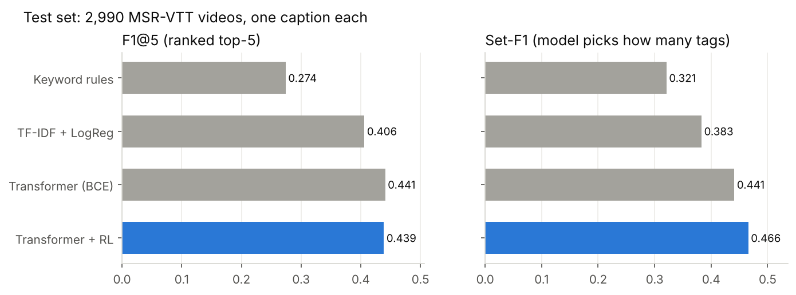
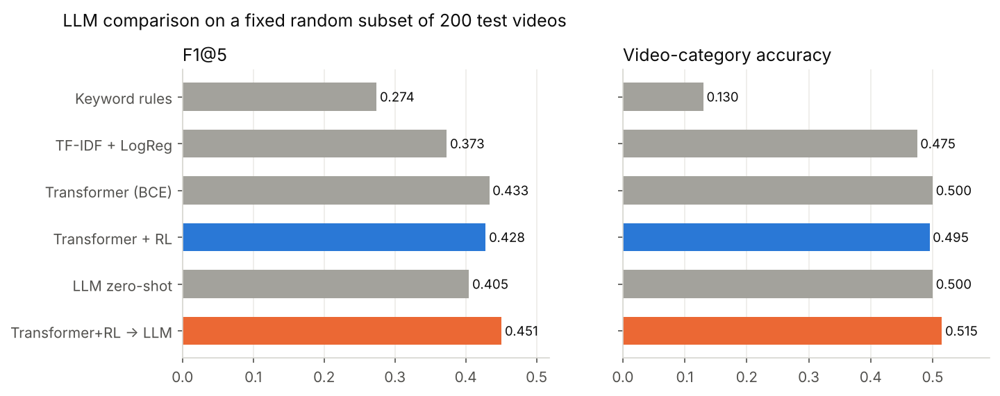
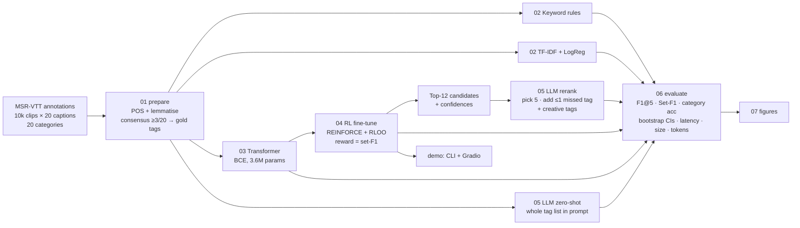
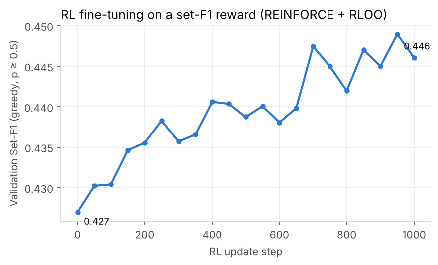

# 🎬 Caption-to-Hashtag: RL-tuned Transformer + LLM rerank for video hashtags

**Given a one-sentence description of a video, generate the hashtags people would use for it, across 20 kinds of video (music, gaming, cooking, autos, news, beauty, ...).**

An end-to-end, CPU-only project. It covers dataset choice, weak-supervision labelling, three trained models, **reinforcement-learning fine-tuning on a set-level reward**, and an **LLM stage that reranks the model's candidates**. Every number below comes from scripts in this repo, with significance tests and an efficiency benchmark.

```text
"a chef slices onions and fries them in a pan"
  → #food  #kitchen  #pan  #onion  #preparing  #vegetable  #cooking  #dish
"kids playing minecraft and building a house"
  → #game  #minecraft  #gaming
"two teams compete in a basketball game in front of a crowd"
  → #sports  #game  #player  #basketball  #ball
```

---

## TL;DR results

| Test set: 2,990 videos | F1@5 | Set-F1 | Category acc | Latency (CPU, 1 thread) | Size |
|---|---|---|---|---|---|
| Keyword rules (no learning) | 0.274 | 0.321 | 0.141 | 0.17 ms | – |
| TF-IDF + logistic regression | 0.406 | 0.383 | 0.491 | 0.64 ms | 43 MB |
| Transformer, BCE | **0.441** | 0.441 | **0.517** | 1.73 ms | 14 MB |
| **Transformer + RL (ours)** | 0.439 | **0.466** | 0.515 | 1.83 ms | 14 MB |

| LLM subset: 200 test videos | F1@5 | Set-F1 | Category acc | LLM tokens / video |
|---|---|---|---|---|
| Transformer + RL | 0.428 | 0.448 | 0.495 | 0 |
| LLM zero-shot (Claude, whole tag list in prompt) | 0.405 | 0.424 | 0.500 | ~915 |
| **Transformer + RL → LLM rerank (ours)** | **0.451** | **0.451** | **0.515** | **~289** |

**Takeaways**
1. **Learning beats rules by a wide margin:** F1@5 rises from 0.274 to 0.441 (+61%). Category accuracy rises from 14% to 52%, because a caption rarely names its own category.
2. **RL fine-tuning improves what users actually see.** Set-F1 is the score of the tag set the model chooses to emit. RL lifts it by **+0.025 [95% CI +0.019, +0.030]** over the same model trained with BCE. It even edges out BCE with a threshold tuned on validation (+0.005, CI [+0.000, +0.009], marginal). After RL, the default threshold of 0.5 is already about optimal: the policy has learned how many tags to emit.
3. **The fine-tuned model plus an LLM beats either one alone.** The hybrid beats the RL model by **+0.022 F1@5 [+0.001, +0.045]** and the zero-shot LLM by **+0.027 [+0.006, +0.047]**, while using **~3× fewer prompt tokens** than zero-shot. The LLM only sees 12 candidates, not the whole 367-tag vocabulary.
4. **Efficiency:** the Transformer serves about 1,200 captions/s on one CPU thread at under 2 ms each, in a 14 MB checkpoint. The LLM stage is optional polish, so the system never *depends* on it.

<p align="center"></p>
<p align="center"></p>

---

## 1. Problem framing

Creators describe a video in one line. Platforms want **hashtags** for search, recommendation and reach. The difficulty is that **a caption doesn't spell out its hashtags**. "a man drives an audi through the countryside" should yield `#autos #car #driving #road`, and a good tagger must infer the *category* and the *topic tags other viewers would use*, not just copy words.

**Task formulation:** multi-label prediction over a hashtag vocabulary of 367 tags, plus 20 category tags. Input: one caption. Output: either a ranked list (scored by **F1@5**) or a set whose size the model chooses (scored by **Set-F1**).

## 2. Dataset: why MSR-VTT

| Candidate | Why / why not |
|---|---|
| **MSR-VTT** (Xu et al., CVPR 2016) ✅ | 10,000 YouTube clips × **20 human captions each** (200k sentences) × **20 video categories**. Standard splits, small annotation file (~4 MB), widely cited. |
| YouTube-8M | Has topic labels, but no natural-language captions. |
| Scraped TikTok / Instagram hashtag dumps | Real hashtags, but noisy, spam-heavy, and unclear licensing. Hard to reproduce. |
| VATEX | Good alternative (41k clips with captions). Its labels are Kinetics *actions*, not video categories. |

Split: the standard **6,513 train / 497 validation / 2,990 test** clips.

### Labels from annotator consensus (weak supervision)

MSR-VTT has no hashtags, so the labels are built in `src/hashtagger/data.py`:

1. **Category hashtag:** the clip's category becomes `#music`, `#gaming`, `#autos`, `#howto`, and so on. Category names are reserved for this use, so `#cooking` means *this is a cooking video*.
2. **Topic hashtags:** each of the 20 captions is POS-tagged and lemmatised. Nouns are made singular (`cars` → `car`) and verbs become their gerund (`sings` → `singing`; the gerund for each verb is learned from the corpus). A term becomes a **gold tag if ≥ 3 of the 20 annotators independently mention it.** Generic words (`man`, `video`, `talking`) and visual-detail words (`shirt`, `chair`) are filtered out.
3. The vocabulary is built from **training clips only**: 367 tags, including the 20 category tags. Clips average 4.1 gold tags.

At test time the model sees **one** randomly chosen caption (fixed seed) and must predict tags agreed on by the **other** annotators. Training uses all 20 captions per clip, so 130k examples.

## 3. Pipeline



| Step | Script | Time (2 vCPU) |
|---|---|---|
| Build labels | `scripts/01_prepare_data.py` | 40 s |
| Baselines | `scripts/02_train_baselines.py` | 1.5 min |
| Transformer (BCE) | `scripts/03_train_transformer.py` | 24 min |
| RL fine-tune | `scripts/04_rl_finetune.py` | 8 min |
| LLM stages | `scripts/05_llm_hashtags.py --stage zero_shot / hybrid` | cached |
| Evaluate + benchmark | `scripts/06_evaluate.py` | 15 s |
| Figures | `scripts/07_make_figures.py` | 3 s |

## 4. Models

**0 · Keyword rules.** Hashtags are the vocabulary terms that literally appear in the caption, padded with the most popular tags. This is what a naive tool does.

**1 · TF-IDF + logistic regression.** Word 1–2-gram TF-IDF (30k features) feeding one linear layer with sigmoid outputs: one-vs-rest logistic regression for all 367 tags at once. Trained with Adagrad, with output biases initialised to the label prior.

**2 · Transformer (BCE).** Trained from scratch: word tokenizer (13.5k words) → `[CLS]` + learned positions → 2-layer pre-LN encoder (d=192, 4 heads) → masked mean-pool → MLP → 367 logits. Binary cross-entropy, AdamW with one-cycle LR, 6 epochs. **3.6M parameters.**

**3 · Transformer + RL (ours).** The model is treated as a **policy** over tag sets, π(S | caption) = ∏ⱼ Bernoulli(sⱼ; σ(zⱼ)), and fine-tuned to maximise the metric users actually experience:

```
sample   K = 4 tag-sets  S₁..S₄ ~ π(· | caption)
reward   r(S) = F1(S, gold)                      ← any black-box reward plugs in here
baseline bᵢ = mean_{k≠i} r(S_k)                   ← RLOO (Ahmadian et al., 2024)
loss     −(rᵢ − bᵢ) · log π(Sᵢ)  +  0.5 · BCE     ← supervised anchor, like the SFT/KL anchor in RLHF
decode   greedy:  sⱼ = 1  iff  pⱼ ≥ 0.5
```

*Why RL?* BCE optimises each tag independently. It doesn't learn *how many* tags to emit, or that tags should be right *together*. Set-F1 is non-differentiable; policy gradients optimise it directly. The leave-one-out baseline needs no learned critic, which is the same design choice as RLOO / GRPO in LLM RLHF. The reward function is the extension point: swap in an LLM-judge score (RLAIF) or click-through data without touching the training loop.

<p align="center"></p>

**4 · LLM zero-shot.** The LLM gets the caption plus the full allowed-tag list (~900 prompt tokens) and returns 5 tags as JSON.

**5 · Transformer + RL → LLM rerank (ours).** The RL model proposes its **top-12 candidates with confidences** (~260 prompt tokens). The LLM picks the best 5, drops candidates that contradict the caption, may add **one** missed tag from the vocabulary, and suggests up to 2 open-vocabulary "creative" tags for reach. The creative tags aren't scored. A validator (`enforce_constraints`) applies to both LLM stages: it keeps exactly one category tag and refills dropped slots from the candidates. LLMs routinely break "exactly one" rules, for example by answering `#food` + `#cooking`.

The LLM client (`src/hashtagger/llm/client.py`) is provider-agnostic: **Anthropic, OpenAI, or any OpenAI-compatible server such as Ollama or vLLM**. Every response is written to `data/llm_cache/*.jsonl`, so results reproduce offline with **no API key**.

## 5. Results in detail

Full tables: [`results/results.md`](results/results.md). Raw numbers: [`results/metrics.json`](results/metrics.json).

### Significance (paired bootstrap, 5,000 resamples)

| Comparison | Δ | 95% CI |
|---|---|---|
| RL vs BCE (Set-F1, full test) | +0.025 | [+0.019, +0.030] |
| RL vs BCE with val-tuned threshold (Set-F1) | +0.005 | [+0.000, +0.009] |
| Hybrid vs RL (F1@5, LLM subset) | +0.022 | [+0.001, +0.045] |
| Hybrid vs LLM zero-shot (F1@5, LLM subset) | +0.027 | [+0.006, +0.047] |

### Per kind of video

<p align="center"></p>

Concrete, visual categories (`#autos`, `#sports`, `#gaming`) reach about 0.55 F1@5. Categories defined by *format* rather than content (`#ads`, `#tvshow`, `#people`) stay hard: an ad for a car is described as a car.

### Efficiency

<p align="center"></p>

| Model | p50 latency | Throughput (batched) | Size | Params | Train time |
|---|---|---|---|---|---|
| Keyword rules | 0.17 ms | 6.1k/s | – | – | – |
| TF-IDF + LogReg | 0.64 ms | 30.5k/s | 43 MB | 11.0M | 1.5 min |
| Transformer + RL | 1.83 ms | 1.2k/s | 14 MB | 3.6M | 32 min total |
| + LLM rerank | + one LLM call | – | – | – | ~263 in / 26 out tokens |

### Examples (test set)

| Caption (model input) | Gold (other annotators) | Keyword rules | Transformer + RL | + LLM rerank (✨ creative) |
|---|---|---|---|---|
| *a rock band is playing on stage* | band concert crowd music performing rock song stage | stage band rock | band music performing stage singing song concert | music band rock stage concert ✨rockband livemusic |
| *a soup is been prepared and its been kept in the cup* | bowl dish food pot recipe serving soup spoon | soup | food soup bowl preparing dish cooking kitchen | cooking soup bowl preparing dish ✨souprecipe comfortfood |
| *several jockeys are riding their horses around a race trek* | horse race riding sports track winning | riding horse race | horse race animals track riding racing | sports horse race racing riding ✨horseracing jockey |
| *a helicopter flies over rooftops while gunfire is heard and a narrator mentions syria* | fighting flying news shooting war | flying | flying travel sky plane air | news flying war plane sky ✨breakingnews syria |

The last row shows where the LLM earns its keep: world knowledge (*Syria* + gunfire → `#news #war`) that a 3.6M-parameter model trained on 6.5k clips doesn't have.

## 6. Lessons learned (debugging notes)

- **Weight decay plus an adaptive optimiser silently broke the linear baseline.** With Adam or Adagrad, an L2 term is added to the gradient and then *normalised per coordinate*. For a sparse n-gram feature that is absent from a batch, the only gradient is the tiny decay term, so even `1e-6` decay becomes a full-size step toward zero. The model gave *"a dog is running"* a 12% chance of `#dog`, against a 92% empirical rate. Setting `weight_decay=0` lifted validation F1@5 from 0.27 to 0.39. (AdamW decouples decay, which is why the Transformer was unaffected.)
- **Label namespaces matter.** At first, category names (`cooking`, `music`) were also ordinary topic tags. A food video that *mentions* cooking then got `#cooking`, which blurred the category signal. Reserving category names fixed it.
- **Use the standard P@k denominator.** Dividing by the number of returned tags instead of k flattered the sparse keyword baseline.
- **Initialise output biases to the label prior.** With 367 labels and about 1% positives, starting at p = 0.5 wastes the first epoch unlearning it.

## 7. Honest limitations

- **LLM numbers come from 200 videos** (cost-bounded by design), so their CIs are wide. **The LLM outputs in `data/llm_cache/` were produced by Claude (`claude-opus-5-5`) answering the exact prompts in `src/hashtagger/llm/prompts.py`.** They were recorded through the script's `--export-pending` / `--import-answers` batch workflow, because the build environment had no API access. That is why token counts are estimated at ~4 characters per token and **LLM latency was not measured**. Re-run live with `--provider anthropic` (or `openai` / `ollama`) to replace the cache and get measured latency and usage.
- **Labels are weak supervision** (annotator consensus). They capture what people *see*, not what is *trending*. MSR-VTT categories are themselves noisy (`#people` vs `#music`).
- **Text-only.** The model never sees frames or audio.
- **RL vs a tuned threshold:** the gain is small (+0.005) once BCE gets a tuned threshold. RL's practical advantage here is that it bakes the right decision rule into the model and opens the door to non-differentiable rewards. It is not a large accuracy jump.

## 8. Next steps

- **RLAIF:** use the LLM as a reward model (judge tag relevance) in `rl_finetune`, then compare against the F1 reward.
- **Distillation:** train the Transformer on LLM-reranked labels to get most of the hybrid's gain at 2 ms.
- **Multimodal:** add CLIP frame embeddings next to the caption encoder.
- **Popularity-aware tags:** mix in a trending-hashtag prior for the creative tags.

---

## Repository layout

```text
video-hashtag-llm/
├── README.md
├── LICENSE
├── Makefile                      # make all | data | baselines | transformer | rl | llm | eval | figures | test | demo
├── requirements.txt
├── configs/
│   └── default.yaml              # every hyper-parameter in one place
├── scripts/
│   ├── download_data.sh          # MSR-VTT annotations (~4 MB) + NLTK data
│   ├── 01_prepare_data.py        # consensus labels → data/processed/
│   ├── 02_train_baselines.py     # keyword rules, TF-IDF + LogReg
│   ├── 03_train_transformer.py   # supervised BCE training
│   ├── 04_rl_finetune.py         # REINFORCE + RLOO on set-F1
│   ├── 05_llm_hashtags.py        # LLM zero-shot / hybrid (live, cached or batch import)
│   ├── 06_evaluate.py            # metrics, bootstrap CIs, latency/size benchmark
│   └── 07_make_figures.py
├── src/hashtagger/
│   ├── data.py                   # loading, split, weak-supervision labelling
│   ├── text.py                   # POS tagging, lemmatisation, gerund mapping, stop-tags
│   ├── metrics.py                # P/R/F1@k, Set-F1, category accuracy
│   ├── predict.py                # Hashtagger inference API (used by demos)
│   ├── utils.py
│   ├── models/
│   │   ├── common.py             # label space, top-k / threshold decoding, threshold tuning
│   │   ├── keyword.py
│   │   ├── tfidf_linear.py
│   │   ├── transformer.py
│   │   └── rl.py                 # policy-gradient fine-tuning
│   └── llm/
│       ├── client.py             # Anthropic / OpenAI / Ollama + response cache + validators
│       └── prompts.py
├── demo/
│   ├── cli.py                    # python demo/cli.py "your caption" [--llm anthropic]
│   └── app.py                    # Gradio web UI
├── tests/
│   └── test_core.py
├── checkpoints/
│   └── transformer_rl.pt         # final model (14 MB), ready for the demo
├── data/
│   └── llm_cache/                # cached LLM responses (zero_shot.jsonl, hybrid.jsonl)
└── results/
    ├── metrics.json  results.md  dataset_stats.json  train_log_*.json  llm_*_usage.json
    ├── llm_subset_ids.json
    ├── preds/llm_*_test_subset.json
    └── figures/*.png
```

## Quickstart

```bash
git clone https://github.com/<you>/video-hashtag-llm && cd video-hashtag-llm
python -m venv .venv && source .venv/bin/activate
pip install torch --index-url https://download.pytorch.org/whl/cpu   # CPU build is enough
pip install -r requirements.txt

# Try the shipped model right away
python demo/cli.py "a woman applies eye makeup in front of a mirror"
python demo/app.py                      # http://localhost:7860

# Reproduce everything (~35 min on a laptop CPU; LLM stages read the cache)
make all
make test

# Re-run the LLM stages live
export ANTHROPIC_API_KEY=...            # or OPENAI_API_KEY / a local Ollama server
python scripts/05_llm_hashtags.py --stage hybrid --provider anthropic --model claude-opus-5-5
```

## References

- J. Xu, T. Mei, T. Yao, Y. Rui. *MSR-VTT: A Large Video Description Dataset for Bridging Video and Language.* CVPR 2016.
- S. Rennie et al. *Self-critical Sequence Training for Image Captioning.* CVPR 2017.
- A. Ahmadian et al. *Back to Basics: Revisiting REINFORCE-Style Optimization for Learning from Human Feedback in LLMs.* ACL 2024.
- R. J. Williams. *Simple statistical gradient-following algorithms for connectionist reinforcement learning.* Machine Learning, 1992.
