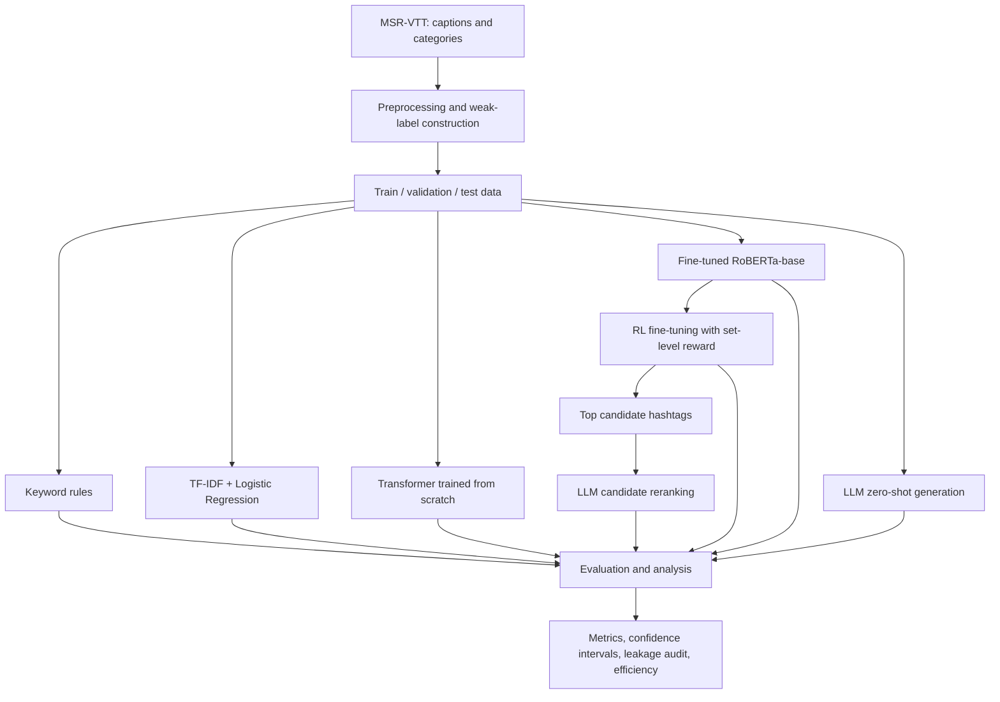
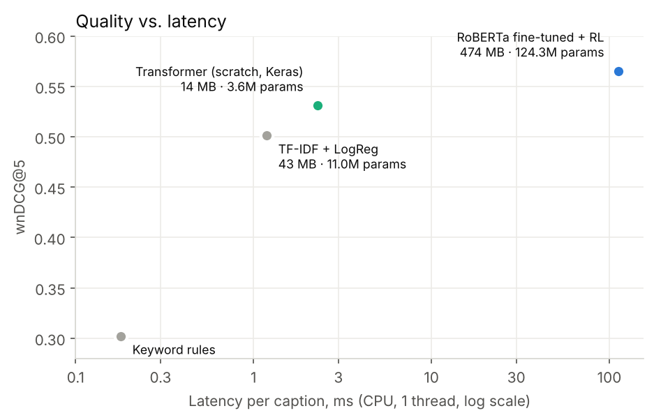
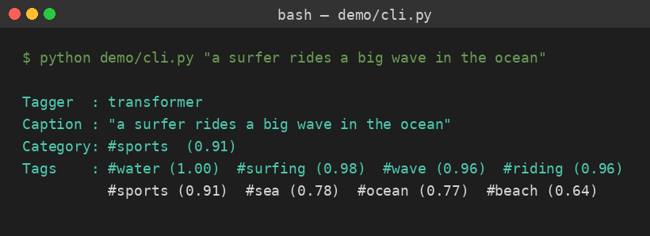
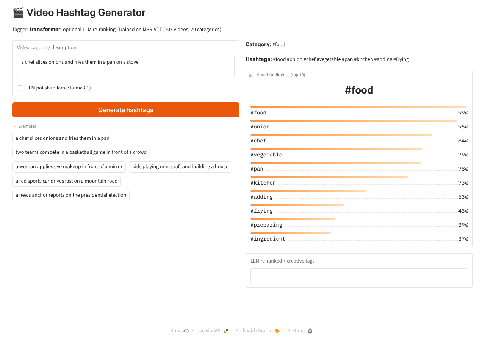
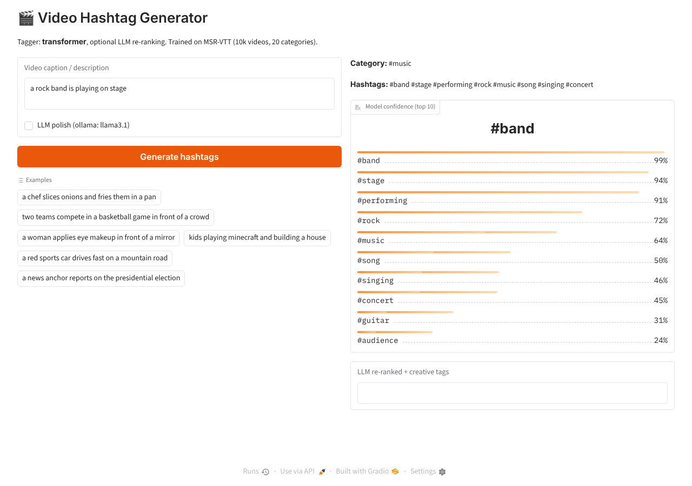

# Caption-to-Hashtag Generation with RoBERTa, Reinforcement Learning, and LLMs

An end-to-end NLP project that generates relevant hashtags from a
one-sentence video description. The system is evaluated across **20
video categories** and compares lightweight baselines, neural text
encoders, a pretrained transformer, reinforcement-learning fine-tuning,
and LLM-based generation and reranking.

> **Project focus:** multi-label text classification, pretrained
> language models, reward-based optimization, evaluation design, and
> model efficiency.

------------------------------------------------------------------------

## 1. Project Overview

### Motivation

Hashtags help users discover video content through search and
recommendation systems. However, a short video description does not
necessarily contain the terms that viewers would use as hashtags. For
example, the caption *"a man drives an Audi through the countryside"*
may imply tags such as `#autos`, `#car`, `#driving`, and `#road`, even
when those exact terms are not all present in the caption.

This project investigates how NLP models can infer both:

-   **Category-level tags**, representing the broad type of video.
-   **Topic-level tags**, representing the specific objects, activities,
    or concepts in the video.

The goal is not simply to extract keywords, but to predict a useful,
ranked set of hashtags from a short natural-language description.

### Task Definition

Given one caption, predict a ranked set of hashtags from a fixed
vocabulary of **367 labels**, including **20 video-category labels**.

-   **Input:** one natural-language video caption.
-   **Output:** a ranked list or predicted set of hashtags.
-   **Task formulation:** multi-label prediction.

### Project Highlights

-   Weakly supervised label construction from human-caption consensus.
-   A model comparison ladder, from keyword rules to fine-tuned RoBERTa.
-   REINFORCE/RLOO-style policy-gradient fine-tuning using a set-level
    F1 reward.
-   LLM zero-shot generation and candidate reranking.
-   Evaluation using ranking, coverage, set-prediction, and category
    metrics.
-   Leakage checks, paired bootstrap confidence intervals, and CPU
    efficiency benchmarks.

------------------------------------------------------------------------

## 2. Dataset and Label Construction

### Dataset Selection: MSR-VTT

The project uses **MSR-VTT** (Xu et al., CVPR 2016), a video-captioning
benchmark containing:

-   10,000 YouTube video clips.
-   20 human-written captions per clip (approximately 200,000 captions).
-   20 video categories.
-   Standard train, validation, and test splits.

The standard split used in this project is:

  Split          Number of clips
  ------------ -----------------
  Train                    6,513
  Validation                 497
  Test                     2,990

MSR-VTT was selected because it provides both natural-language
descriptions and video-category annotations. This makes it possible to
construct a reproducible hashtag-prediction task without relying on
scraped social-media hashtags, which can be noisy and difficult to
reproduce.

### Weakly Supervised Hashtag Labels

MSR-VTT does not provide ground-truth social-media hashtags. Therefore,
labels are constructed from the captions written by independent
annotators.

1.  **Category labels:** the annotated video category is mapped to a
    category hashtag (e.g. `#music`, `#gaming`, or `#autos`).
2.  **Topic labels:** captions are POS-tagged and lemmatized. Nouns are
    normalized to singular forms and verbs to gerunds.
3.  **Annotator consensus:** a normalized term is retained as a topic
    label when at least **3 of the 20 captions** mention it.
4.  **Filtering:** generic terms (e.g. `man`, `video`) and visually
    uninformative terms (e.g. `shirt`, `chair`) are removed.
5.  **Vocabulary construction:** the hashtag vocabulary is built using
    training data only.

The resulting label space contains **367 hashtags**. Each clip has an
average of **4.1 gold tags**.

**Evaluation protocol:** the model receives one randomly selected
caption for a clip. Its predictions are compared with labels derived
from the other annotators' captions. The input caption is excluded from
the consensus-based relevance calculation.

> **Important interpretation:** these labels are weak supervision
> derived from caption agreement. They approximate concepts
> independently mentioned by annotators; they are not verified
> real-world trending hashtags or direct measurements of social-media
> engagement.

------------------------------------------------------------------------

## 3. Methodology and Pipeline

The system is developed as a sequence of increasingly expressive
approaches. Each stage provides a comparison point for understanding the
contribution of lexical matching, learned representations, pretraining,
reward optimization, and LLM reasoning.



### Main Stages

  -----------------------------------------------------------------------
  Stage                               Description
  ----------------------------------- -----------------------------------
  Data preparation                    Normalize captions, construct
                                      consensus-based labels, and create
                                      the label vocabulary.

  Baseline modelling                  Establish lexical and conventional
                                      machine-learning baselines.

  Neural modelling                    Train a Transformer encoder from
                                      scratch and fine-tune pretrained
                                      RoBERTa.

  Reward optimization                 Fine-tune RoBERTa with a
                                      policy-gradient objective based on
                                      set-level F1.

  LLM experiments                     Evaluate zero-shot hashtag
                                      generation and LLM reranking of
                                      model candidates.

  Evaluation                          Compare predictive quality,
                                      category performance, robustness,
                                      statistical uncertainty, and
                                      inference cost.
  -----------------------------------------------------------------------

------------------------------------------------------------------------

## 4. Models and Experimental Design

The models are organized as a comparison ladder. Each model addresses a
different question about the value of learning, contextual
representations, pretraining, and reward-based optimization.

  -----------------------------------------------------------------------
  Model                   Approach                Purpose
  ----------------------- ----------------------- -----------------------
  Keyword rules           Caption keyword         Establish a simple
                          matching and            non-learning baseline.
                          popular-tag fallback    

  TF-IDF + Logistic       Word unigram/bigram     Measure the value of
  Regression              features with           supervised learning
                          multi-label sigmoid     with sparse lexical
                          outputs                 features.

  Transformer from        Lightweight Transformer Evaluate contextual
  scratch                 encoder implemented in  representation learning
                          TensorFlow/Keras        without pretrained
                                                  weights.

  RoBERTa-base (BCE)      Pretrained RoBERTa      Measure the
                          encoder with a          contribution of
                          multi-label             large-scale
                          classification head     language-model
                                                  pretraining.

  **RoBERTa-base + RL**   RoBERTa fine-tuning     Optimize the predicted
                          followed by             tag set using a
                          policy-gradient         task-level reward.
                          optimization            

  LLM zero-shot           Prompt an LLM to        Assess generation
                          generate hashtags       without task-specific
                          directly from a caption supervised training.

  RoBERTa + RL + LLM      LLM selects or reorders Assess whether LLM
  reranking               candidates proposed by  reasoning improves
                          the best tagger         candidate selection.
  -----------------------------------------------------------------------

### RoBERTa Multi-label Classifier

The main supervised model uses **RoBERTa-base** as its text encoder:

-   Byte-level BPE tokenization.
-   12-layer RoBERTa-base encoder with a 768-dimensional hidden
    representation.
-   Masked mean pooling over token representations.
-   Dropout and a linear classification head.
-   367 output logits, one for each hashtag label.
-   Binary cross-entropy (BCE) for multi-label supervised fine-tuning.

The model contains approximately **124M parameters**. Checkpoints are
selected using validation performance.

### Reinforcement-Learning Fine-tuning

The RL stage treats the hashtag predictor as a policy over possible tag
sets. Each label is sampled from a Bernoulli distribution parameterized
by the model's predicted probability.

The optimization uses:

-   **Reward:** set-level F1 between a sampled tag set and the gold
    labels.
-   **Policy-gradient estimator:** REINFORCE.
-   **Baseline:** leave-one-out reward baseline (RLOO), computed from
    the other sampled tag sets.
-   **Supervised anchor:** a BCE term is retained to reduce deviation
    from the supervised model.

This design targets a limitation of independent BCE classification: BCE
optimizes each label separately, whereas the final application evaluates
a set of predicted tags. The RL stage therefore explores direct
optimization of a set-level objective.

### LLM Experiments

Two LLM settings are evaluated:

1.  **Zero-shot generation:** the caption and allowed hashtag vocabulary
    are provided to the LLM, which returns a set of candidate hashtags.
2.  **Candidate reranking:** RoBERTa + RL proposes candidate hashtags
    and confidence scores; the LLM selects and may suggest additional
    tags under the prompt's output constraints.

LLM experiments are evaluated on a fixed **200-clip test subset**. Their
results should therefore be interpreted separately from the full-test
model comparison.

------------------------------------------------------------------------

## 5. Evaluation Metrics

No single metric fully captures hashtag quality. The evaluation suite
therefore considers ranking quality, relevance coverage, set prediction,
and category recognition.

  -----------------------------------------------------------------------
  Metric                  What it measures        Role
  ----------------------- ----------------------- -----------------------
  **wnDCG@5**             Ranking quality with    Primary
                          relevance weighted by   
                          annotator agreement;    
                          the primary metric.     

  nDCG@5                  Ranking quality using   Supporting
                          binary relevance.       

  wRecall@5               Proportion of           Supporting
                          annotator-derived       
                          relevance votes covered 
                          by the top five         
                          predictions.            

  Hit@5                   Proportion of clips     Supporting
                          with at least one       
                          relevant prediction in  
                          the top five.           

  Set-F1                  Precision-recall        Supporting
                          balance for the set     
                          emitted by the model.   

  Category top-1 / top-2  Accuracy of the         Supporting
                          predicted video         
                          category.               

  Category macro-F1       Category performance    Supporting
                          while accounting for    
                          class imbalance.        
  -----------------------------------------------------------------------

### Why wnDCG@5?

A binary metric treats every gold tag as equally relevant. However, the
consensus process contains different levels of annotator agreement.
wnDCG@5 incorporates the proportion of the other captions that mention
each tag, giving more weight to tags with stronger annotator support.

The relevance calculation excludes the input caption, reducing the
benefit of simply copying words from the model input.

### Statistical Analysis

Model comparisons use **paired bootstrap confidence intervals (5,000
resamples)**. This estimates uncertainty in performance differences
while preserving the paired nature of predictions on the same test
examples.

------------------------------------------------------------------------

## 6. Results

### Full Test-set Performance

The primary comparison uses all **2,990 test clips**. The main metric is
wnDCG@5.

  -----------------------------------------------------------------------------------
  Model                   wnDCG@5        Hit@5       Set-F1     Category     Category
                                                                   top-1        top-2
  ------------------ ------------ ------------ ------------ ------------ ------------
  Keyword rules             0.302        76.2%        0.321        14.1%        24.2%

  TF-IDF + Logistic         0.501        83.4%        0.387        48.7%        62.0%
  Regression                                                             

  Transformer from          0.531        85.3%        0.447        52.1%        65.3%
  scratch                                                                

  RoBERTa-base (BCE)        0.559    **88.8%**        0.472    **54.7%**        69.2%

  **RoBERTa-base +      **0.565**        88.2%    **0.489**        54.6%    **69.4%**
  RL**                                                                   
  -----------------------------------------------------------------------------------

**Best result:** RoBERTa-base + RL achieves the highest wnDCG@5
(**0.565**) and Set-F1 (**0.489**) among the full-test comparisons.
RoBERTa-base with BCE achieves the highest Hit@5 (**88.8%**) and
category top-1 accuracy (**54.7%**).

### LLM Results

LLM experiments are evaluated on a fixed 200-clip subset. On this
subset:

  Model                            wnDCG@5
  ------------------------------ ---------
  RoBERTa-base + RL                  0.592
  LLM zero-shot                      0.514
  RoBERTa + RL → LLM reranking       0.543

These values are **not directly comparable with the full-test table**,
because they are computed on a smaller subset. On the shared subset, the
LLM reranking stage does not improve wnDCG@5 over RoBERTa + RL.

### Statistical Comparison

Selected paired-bootstrap comparisons on the full test set:

  -----------------------------------------------------------------------
  Comparison              Difference in wnDCG@5                    95% CI
  ------------------- ------------------------- -------------------------
  RoBERTa + RL                           +0.034        \[+0.026, +0.043\]
  vs. Transformer                               
  from scratch                                  

  RoBERTa + RL                           +0.064        \[+0.055, +0.073\]
  vs. TF-IDF +                                  
  Logistic Regression                           

  RoBERTa + RL                           +0.263        \[+0.252, +0.274\]
  vs. Keyword rules                             

  RoBERTa + RL                           +0.007        \[+0.003, +0.011\]
  vs. RoBERTa (BCE)                             
  -----------------------------------------------------------------------

The reported intervals for these comparisons exclude zero, indicating
positive differences under the paired-bootstrap analysis.

### Result Visualizations

The repository includes generated figures for overall model quality,
category-level performance, RL training behavior, LLM comparisons, and
efficiency.

<p align="center">

</p>
<p align="center">

</p>
<p align="center">

</p>
<p align="center">

</p>

------------------------------------------------------------------------

## 7. Discussion

### 7.1 Pretraining Provides the Largest Modelling Gain

RoBERTa improves over the Transformer trained from scratch by **0.028
wnDCG@5** with BCE fine-tuning and **0.034** with RL fine-tuning. This
suggests that pretrained contextual representations are useful for
inferring concepts that may not appear literally in a short caption.

The improvement is not uniform across categories. The project reports
stronger gains in categories such as news, food, movies, and travel,
while some categories show smaller gains or regressions. This indicates
that model performance depends partly on the semantic structure of each
category.

### 7.2 RL Improves Set-level Prediction, but Its Benefit Is Metric-dependent

Compared with RoBERTa trained using BCE, RL improves:

-   Set-F1 at the default 0.5 threshold by **0.017**.
-   wnDCG@5 by **0.007**.

However, the RL model does not lead on every metric. RoBERTa-BCE has a
slightly higher Hit@5 and category top-1 accuracy. In addition, tuning
the BCE model's decision threshold on validation data matches the RL
model's Set-F1 in the reported experiment.

This suggests that the benefit of RL should be interpreted in relation
to the chosen reward and deployment objective, rather than as a
universal improvement over supervised fine-tuning.

### 7.3 LLMs Add Generative Flexibility, but Do Not Automatically Improve Ranking

The LLM can introduce world knowledge and creative, open-vocabulary
suggestions. Nevertheless, the reranking experiment does not outperform
RoBERTa + RL on wnDCG@5 in the evaluated subset.

One observed issue is that prompt-level constraints---such as requiring
exactly one category tag---can remove plausible alternatives that are
useful under the evaluation metric. This highlights the importance of
aligning prompting rules with the target evaluation and product
requirements.

### 7.4 Accuracy Must Be Considered Alongside Efficiency

The best-performing model is not necessarily the best deployment choice.

  Model                        wnDCG@5   CPU latency (p50)   Model size
  -------------------------- --------- ------------------- ------------
  Transformer from scratch       0.531              2.3 ms        14 MB
  RoBERTa + RL                   0.565              113 ms       474 MB

RoBERTa + RL provides higher ranking quality, but the lightweight Keras
Transformer has substantially lower latency and storage requirements.
The appropriate choice depends on whether the application prioritizes
maximum offline quality or low-latency, resource-efficient inference.

------------------------------------------------------------------------

## 8. Limitations and Future Work

### Limitations

-   **Weakly supervised labels:** consensus among video captions is only
    a proxy for hashtags that real users might choose. It does not
    measure hashtag popularity, trends, or engagement.
-   **Text-only input:** the current system uses captions rather than
    visual video frames. Some visual concepts may therefore be
    unavailable or ambiguous.
-   **LLM evaluation scale:** LLM results are based on a fixed 200-clip
    subset and should be interpreted with this limitation in mind.
-   **Evaluation coverage:** automatic metrics cannot fully assess
    whether a plausible but unseen hashtag is useful. Human evaluation
    or online engagement measurements would provide complementary
    evidence.
-   **Compute and model size:** the RoBERTa checkpoint is comparatively
    large and is not included in the repository because of GitHub's
    file-size limit.

### Future Work

1.  **Multimodal learning:** incorporate video-frame representations,
    for example using CLIP embeddings, alongside the text encoder.
2.  **Knowledge- or preference-aware rewards:** investigate
    LLM-as-a-judge or user-feedback signals as alternative reward
    functions.
3.  **Model compression:** distill the RoBERTa model into the
    lightweight Transformer or explore quantization and optimized
    inference.
4.  **Human evaluation:** assess relevance, usefulness, and diversity of
    generated hashtags with human annotators.
5.  **Real-world evaluation:** measure tag acceptance, editing behavior,
    and downstream discovery or engagement when suitable platform data
    is available.

------------------------------------------------------------------------

## 9. Reproducibility and Quickstart

The project is designed to run on CPU, although training can be faster
with a suitable GPU. The reported end-to-end runtime is approximately
**2.3 hours on a 2-core CPU**, depending on environment and dependency
versions.

### Installation

``` bash
git clone https://github.com/<your-username>/video-hashtag-llm.git
cd video-hashtag-llm

python -m venv .venv
source .venv/bin/activate  # Windows: .venv\Scripts\activate

pip install torch --index-url https://download.pytorch.org/whl/cpu
pip install -r requirements.txt
```

### Run the Demo

The lightweight Keras Transformer checkpoint is included for inference:

``` bash
python demo/cli.py "a woman applies eye makeup in front of a mirror"
python demo/app.py
```

The Gradio interface is available locally at `http://localhost:7860`.

**Below are real outputs from this repository** — the CLI run on the
shipped 14 MB Keras Transformer checkpoint, and the Gradio web UI
answering two different captions live:

<p align="center">
 #water #surfing #wave #riding #sports #sea #ocean #beach">
</p>
<p align="center">
 #food #onion #chef #vegetable #pan #kitchen #adding #frying">
</p>
<p align="center">
 #band #stage #performing #rock #music #song #singing #concert">
</p>

### Reproduce the Experiments

``` bash
# Run the complete pipeline
make all

# Resume an interrupted RoBERTa training run
make roberta RESUME=1

# Run tests
make test
```

### Run LLM Experiments

Configure a supported provider and API key, or use a local Ollama setup:

``` bash
export ANTHROPIC_API_KEY=<your-api-key>
python scripts/05_llm_hashtags.py --stage hybrid --provider anthropic --model <model-name>
```

LLM responses are cached to support repeatable evaluation without
repeatedly calling the provider.

------------------------------------------------------------------------

## 10. Repository Structure

``` text
video-hashtag-llm/
├── configs/                 # Experiment configuration
├── data/
│   └── llm_cache/           # Cached LLM responses
├── demo/                    # CLI and Gradio demo
├── docs/                    # Extended project report + demo screenshots
│   └── screenshots/         # Real CLI and Gradio demo screenshots
├── scripts/                 # Data, training, evaluation, and plotting scripts
├── src/hashtagger/
│   ├── models/              # Baseline, Transformer, RoBERTa, and RL models
│   ├── llm/                 # LLM clients, prompts, and response validation
│   ├── data.py              # Data loading and weak-label construction
│   ├── metrics.py           # Evaluation metrics
│   └── predict.py           # Inference interface
├── checkpoints/             # Lightweight demo checkpoint and label metadata
├── results/
│   ├── figures/             # Result visualizations
│   ├── metrics.json         # Raw evaluation metrics
│   └── results.md           # Detailed result tables
├── tests/                   # Unit and core functionality tests
├── Makefile
├── requirements.txt
└── README.md
```

------------------------------------------------------------------------

## 11. Technologies

-   **Programming:** Python
-   **Deep learning:** PyTorch, TensorFlow, Keras
-   **NLP:** NLTK, TF-IDF, RoBERTa, Hugging Face-compatible pretrained
    models
-   **Optimization:** Binary cross-entropy, REINFORCE, RLOO
-   **LLM integration:** Anthropic, OpenAI, Ollama, and vLLM-compatible
    client support
-   **Evaluation:** nDCG, weighted nDCG, precision/recall/F1, paired
    bootstrap
-   **Demo:** Gradio

------------------------------------------------------------------------

## 12. References

1.  Xu, J., Mei, T., Yao, T., & Rui, Y. (2016). *MSR-VTT: A Large Video
    Description Dataset for Bridging Video and Language.* Proceedings of
    CVPR.
2.  Liu, Y., et al. (2019). *RoBERTa: A Robustly Optimized BERT
    Pretraining Approach.* arXiv:1907.11692.
3.  Rennie, S., et al. (2017). *Self-critical Sequence Training for
    Image Captioning.* Proceedings of CVPR.
4.  Ahmadian, A., et al. (2024). *Back to Basics: Revisiting
    REINFORCE-Style Optimization for Learning from Human Feedback in
    LLMs.* Proceedings of ACL.
5.  Järvelin, K., & Kekäläinen, J. (2002). *Cumulated Gain-based
    Evaluation of IR Techniques.* ACM Transactions on Information
    Systems.

------------------------------------------------------------------------

## Notes

-   All reported quantitative results are taken from the experiment
    outputs included in this repository.
-   The LLM comparison uses a 200-example subset; it is reported
    separately from full-test results.
-   The RoBERTa checkpoint is not committed to the repository due to
    GitHub's file-size limit. It can be reproduced using the training
    pipeline.
-   Replace `<your-username>` in the clone URL with the actual GitHub
    account or repository URL before publishing.
