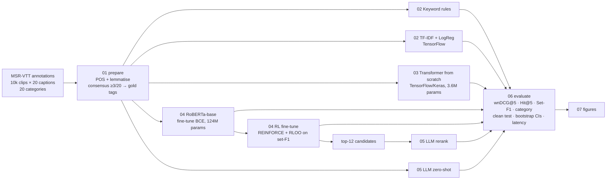
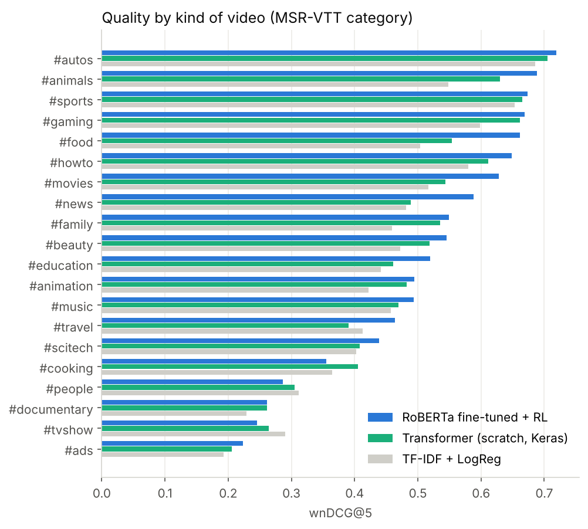

# 🎬 Caption-to-Hashtag: RoBERTa + RL + LLM for video hashtags

**Given a one-sentence description of a video, generate the hashtags people would use for it, across 20 kinds of video (music, gaming, cooking, autos, news, beauty, ...).**

An end-to-end, CPU-only project:
- **dataset choice** and weak-supervision labelling from annotator consensus;
- a **model ladder** from keyword rules to a fine-tuned pretrained **RoBERTa-base**;
- **reinforcement-learning fine-tuning** on a set-level reward;
- an **LLM stage** (zero-shot, and reranking the best model's candidates);
- a **leakage audit**, a metric suite built for this data, bootstrap confidence intervals, an efficiency benchmark;
- a **discussion of the trade-offs** between the optimal model and the cheaper ones (§8).

Every number below comes from scripts in this repo.

```text
Test-set examples (input caption → RoBERTa + RL, threshold 0.5)
"a rock band is playing on stage"
  → #band  #stage  #performing  #music  #singing  #song  #guitar  #rock
"a surfer recalls a horrific experience of near drowning in the rough seas ..."
  → #water  #surfing  #boat  #ocean  #sports  #sea  #swimming  #wave
```

---

## TL;DR results

Test set: **2,990 clips**, one caption each. Primary metric: **wnDCG@5** (§5; ceiling 1.0).

| Model | wnDCG@5 | Hit@5 | Set-F1 | Category top-1 / top-2 | Latency (CPU, 1 thread) | Size |
|---|---|---|---|---|---|---|
| Keyword rules (no learning) | 0.302 | 76.2% | 0.321 | 14.1% / 24.2% | 0.2 ms | – |
| TF-IDF + logistic regression (TensorFlow) | 0.501 | 83.4% | 0.387 | 48.7% / 62.0% | 1.2 ms | 43 MB |
| Transformer from scratch (TensorFlow/Keras) | 0.531 | 85.3% | 0.447 | 52.1% / 65.3% | 2.3 ms | 14 MB |
| RoBERTa-base fine-tuned (BCE) | 0.559 | **88.8%** | 0.472 | **54.7%** / 69.2% | 113 ms | 474 MB |
| **RoBERTa-base fine-tuned + RL** (optimal) | **0.565** | 88.2% | **0.489** | 54.6% / **69.4%** | 113 ms | 474 MB |

LLM stages are scored on a fixed 200-clip subset (§7): **LLM zero-shot 0.514** and **RoBERTa + RL → LLM rerank 0.543**, against **0.592 for RoBERTa + RL** on the same clips.

**Takeaways**
1. **Pretraining is the biggest gain among learned models.** RoBERTa + RL beats the Transformer trained from scratch by **+0.034 wnDCG@5 [95% CI +0.026, +0.043]** and TF-IDF by **+0.064 [+0.055, +0.073]**. The gain is largest on `#news`, `#food`, `#movies`, `#travel`, where world knowledge matters.
2. **RL teaches the model how many tags to emit.** It raises Set-F1 at the default 0.5 threshold by **+0.017 [+0.011, +0.022]** (2.6 → 3.4 tags per clip; gold has 4.1) and wnDCG@5 by +0.007 [+0.003, +0.011].
3. **…but simple threshold tuning gets the same Set-F1.** RoBERTa-BCE with a validation-tuned threshold matches RL: **Δ 0.000 [−0.005, +0.005]**. RL's real value is robustness to the threshold and a plug-in reward for RLAIF (§8.2).
4. **The LLM adds knowledge and creativity, not ranking quality.** Reranking RoBERTa + RL's candidates ties on F1@5 (+0.006, n.s.) and **loses on wnDCG@5 (−0.049 [−0.076, −0.023])**, mostly because a product rule (exactly one category tag) removes the model's hedge between two categories (§8.3).
5. **No leakage found.** 0 test clips share a YouTube source with train/val. On a "clean" test without the 11.6% of clips whose caption appears verbatim in training, RoBERTa + RL scores 0.565 → 0.565.
6. **Quality costs ~50× latency and ~34× size.** RoBERTa + RL: 113 ms / 474 MB; the Keras Transformer: 2.3 ms / 14 MB, at 94% of its wnDCG@5. Which one to ship depends on the scenario (§8.5).

<p align="center"></p>

---

## 1. Problem framing

Creators describe a video in one line. Platforms want **hashtags** for search, recommendation and reach. A caption doesn't spell out its hashtags: *"a man drives an audi through the countryside"* should yield `#autos #car #driving #road`. A good tagger must infer the **category** and the **topic tags other viewers would use**, not just copy words.

**Task:** multi-label prediction over **367 hashtags** (including 20 category tags). Input: one caption. Output: a ranked list, or a set whose size the model chooses.

## 2. Dataset: why MSR-VTT

| Candidate | Why / why not |
|---|---|
| **MSR-VTT** (Xu et al., CVPR 2016) ✅ | 10,000 YouTube clips × **20 human captions each** (200k sentences) × **20 video categories**. Standard splits, ~4 MB annotation file, widely cited. |
| YouTube-8M | Topic labels, but no natural-language captions. |
| Scraped TikTok / Instagram hashtags | Real hashtags, but noisy, spam-heavy, unclear licensing; hard to reproduce. |
| VATEX | 41k captioned clips, but its labels are Kinetics *actions*, not video categories. |

Split: the standard **6,513 train / 497 validation / 2,990 test** clips.

### Labels from annotator consensus (weak supervision)

MSR-VTT has no hashtags, so labels are built in `src/hashtagger/data.py`:
1. **Category hashtag:** the clip's category → `#music`, `#gaming`, `#autos`, `#howto`, …. Category names are reserved for this, so `#cooking` means *this is a cooking video*.
2. **Topic hashtags:** each caption is POS-tagged and lemmatised with NLTK; nouns become singular (`cars` → `car`), verbs become gerunds (`sings` → `singing`). A term becomes a **gold tag if ≥ 3 of the 20 annotators independently mention it**. Generic words (`man`, `video`) and visual-detail words (`shirt`, `chair`) are filtered out.
3. The vocabulary comes from **training clips only**. Clips average 4.1 gold tags.

At test time the model sees **one** randomly chosen caption (fixed seed) and must predict the tags the **other** annotators agreed on.

## 3. Pipeline



| Step | Script | Time (2 vCPU) |
|---|---|---|
| Build labels | `scripts/01_prepare_data.py` | 40 s |
| Keyword rules + TF-IDF logistic regression | `scripts/02_train_baselines.py` | 2 min |
| Transformer from scratch (Keras) | `scripts/03_train_transformer.py` | 24 min |
| **RoBERTa-base fine-tune, then RL** | `scripts/04_finetune_roberta.py [--resume]` | **79 + 11 min** |
| LLM zero-shot / rerank | `scripts/05_llm_hashtags.py --stage zero_shot / hybrid` | cached |
| Evaluate + benchmark | `scripts/06_evaluate.py` | 20 s |
| Figures | `scripts/07_make_figures.py` | 3 s |

**Frameworks.** TF-IDF + logistic regression and the Transformer are TensorFlow/Keras. RoBERTa fine-tuning uses PyTorch, because its pretrained weights are distributed as a PyTorch model.

## 4. Models — why each one is in the lineup

Each model answers one question, so the gap between neighbours measures one idea.

| # | Model | Question it answers |
|---|---|---|
| 0 | Keyword rules | How far does copying words from the caption get you? (floor) |
| 1 | TF-IDF + logistic regression | How much does *learning* from data add, with no word order or semantics? |
| 2 | Transformer from scratch | How much does a contextual neural encoder add, without pretraining? |
| 3 | RoBERTa-base fine-tuned | How much does *pretraining* on 160 GB of text add? |
| 4 | **RoBERTa + RL** | Does optimising the set-level metric directly beat per-tag BCE? |
| 5 | LLM zero-shot / rerank | What does a general LLM add, alone or on top of the best model? |

**0 · Keyword rules.** Hashtags are vocabulary terms that literally appear in the caption, padded with the most popular tags.

**1 · TF-IDF + logistic regression (TensorFlow).** Word 1–2-gram TF-IDF (30k features, scikit-learn) → one linear layer with sigmoid outputs, trained in TensorFlow with `tf.sparse.sparse_dense_matmul`, BCE and Adagrad (lr 0.5); output biases start at the label prior. This is one-vs-rest logistic regression over all 367 tags at once.

**2 · Transformer from scratch (TensorFlow/Keras)** (`src/hashtagger/models/keras_transformer.py`).
- `keras.layers.TextVectorization` holds the word vocabulary (training captions only), so **the exported model takes raw caption strings** (TF Serving / TFLite ready).
- Token + positional embeddings → 2 pre-LayerNorm encoder blocks (`MultiHeadAttention`, 4 heads, d=192, GELU feed-forward) → masked mean-pool → MLP → 367 logits. **3.6M parameters**, 14 MB `.keras` file.
- `model.fit` with BCE, AdamW, warm-up + cosine decay, gradient clipping, 6 epochs. The decision threshold (0.30) is tuned on validation.

**3 · RoBERTa-base, fine-tuned.** The standard industry recipe for text tagging: a pretrained BERT-family encoder with a multi-label head.
- **Architecture:** byte-BPE → RoBERTa-base (12 layers, 768-d, **124M parameters**) → masked mean-pool → dropout → linear → 367 logits.
- **Training:** all weights fine-tuned with AdamW (encoder lr 3e-5, head 1e-3), 6% warm-up, linear decay, batch 32, dynamic padding, 2 epochs. Each epoch **re-samples 4 of the 20 captions** per clip. Checkpoints are selected on validation only.
- **Weights:** `roberta.source: hf` loads Hugging Face `roberta-base`. The build machine could not reach Hugging Face, so the default `spacy` source loads the **same RoBERTa-base weights** packaged in spaCy's `en_core_web_trf`, hosted on GitHub releases.
- **Resumable:** the full training state is saved every 200 steps with **atomic writes**; `--resume` continues where it stopped. The reported run was paused once after epoch 1 (`results/roberta_resume.json`).

**4 · RL fine-tuning of RoBERTa.** The model is treated as a **policy** over tag sets, π(S | caption) = ∏ⱼ Bernoulli(sⱼ; σ(zⱼ)):

```
sample   K = 4 tag-sets  S₁..S₄ ~ π(· | caption)
reward   r(S) = F1(S, gold)                      ← any black-box reward plugs in here
baseline bᵢ = mean_{k≠i} r(S_k)                   ← RLOO (Ahmadian et al., 2024)
loss     −(rᵢ − bᵢ) · log π(Sᵢ)  +  0.5 · BCE     ← supervised anchor, like the SFT/KL anchor in RLHF
decode   greedy:  sⱼ = 1  iff  pⱼ ≥ 0.5
```

BCE scores each tag independently, so it never learns *how many* tags to emit or which belong *together*. Set-F1 is not differentiable, so policy gradients optimise it directly. The leave-one-out baseline needs no critic (the same design choice as RLOO / GRPO in LLM RLHF). The reward function is the extension point: an LLM-judge score (RLAIF) or click-through data can drop in without changing the loop. One pass, 1 caption per clip, lr 1e-5.

**5 · LLM stages.**
- **Zero-shot:** caption + the full allowed-tag list (~900 prompt tokens) → 5 tags as JSON.
- **Rerank (hybrid):** RoBERTa + RL proposes its **top-12 candidates with confidences** (~260 prompt tokens). The LLM picks the best 5, may add one missed tag, and suggests up to 2 creative tags (not scored). A validator enforces exactly one category tag.
- The client supports **Anthropic, OpenAI, Ollama and vLLM**, and caches every response in `data/llm_cache/`, so results reproduce without an API key.

## 5. Evaluation: why not just F1@5

F1@5 is a poor fit here:
- **Its ceiling is not 1.0.** Clips have 1–10 gold tags, so a perfect oracle scores only F1@5 = 0.79; a clip with one gold tag caps at 0.33.
- **Every tag counts the same.** A tag 18 of 20 annotators mention counts like one only 3 mention.
- **Exact match.** `#movie` vs `#film` is a miss.

The suite (`src/hashtagger/metrics.py`):

| Metric | What it measures |
|---|---|
| **wnDCG@5** (primary) | nDCG where each gold tag's gain = **share of the clip's *other* 19 captions that mention it**; the category tag gets gain 1. The input caption is excluded, so copying it earns nothing. **Ceiling 1.0.** |
| nDCG@5 | The same with binary relevance. |
| wRecall@5 | Share of annotator "votes" covered by the top 5. |
| Hit@5 | Share of clips with ≥ 1 correct tag in the top 5 (user-facing view). |
| Set-F1 | F1 of the set the model chooses to emit (threshold 0.5, or tuned on validation). |
| Category top-1 / top-2 / macro-F1 | Top-2 because categories overlap (cooking vs food); macro-F1 because they are imbalanced. |
| Paired bootstrap 95% CI | 5,000 resamples for every claimed difference. |

Still missing: **LLM-as-judge / human ratings** and **online metrics** (tag acceptance, reach), the only ways to score valid tags absent from the gold set.

## 6. Leakage audit

| Check | Result |
|---|---|
| Test clips from the same **YouTube source** as a train/val clip | **0 / 2,990** |
| Label vocabulary, label prior, TF-IDF vocabulary, Keras `TextVectorization` | **Train only.** RoBERTa uses its frozen pretrained tokenizer. |
| Checkpoint selection, thresholds, RL monitoring | **Validation only.** Test is predicted once, after training. |
| Metric gains | From the **other 19 captions**; the input caption never contributes. |
| LLM stages | Saw only the caption (and candidates), never gold labels. |
| Input caption appears **verbatim** in training | **348 clips (11.6%)**: generic sentences (*"a person is explaining something"*) describing different videos. Results are also reported on the **clean test** (2,642 clips). |

**Clean test (2,642 clips)**

| Model | wnDCG@5 | F1@5 | Hit@5 | Category top-1 |
|---|---|---|---|---|
| Keyword rules | 0.297 | 0.275 | 75.7% | 13.7% |
| TF-IDF + LogReg | 0.493 | 0.398 | 83.2% | 48.0% |
| Transformer from scratch (Keras) | 0.525 | 0.435 | 85.1% | 51.9% |
| RoBERTa-base (BCE) | 0.558 | 0.465 | 89.2% | 55.0% |
| **RoBERTa-base + RL** | **0.565** | 0.460 | 88.6% | 54.8% |

## 7. Results in detail

Full tables: [`results/results.md`](results/results.md). Raw numbers: [`results/metrics.json`](results/metrics.json).

### Significance (paired bootstrap, 5,000 resamples, full test set)

| Comparison | Δ | 95% CI |
|---|---|---|
| RoBERTa+RL vs Transformer from scratch (wnDCG@5) | +0.034 | [+0.026, +0.043] |
| RoBERTa+RL vs TF-IDF + LogReg (wnDCG@5) | +0.064 | [+0.055, +0.073] |
| RoBERTa+RL vs Keyword rules (wnDCG@5) | +0.263 | [+0.252, +0.274] |
| RoBERTa-BCE vs Transformer from scratch (wnDCG@5) | +0.028 | [+0.019, +0.036] |
| RoBERTa+RL vs RoBERTa-BCE (Set-F1, threshold 0.5) | +0.017 | [+0.011, +0.022] |
| RoBERTa+RL vs RoBERTa-BCE (wnDCG@5) | +0.007 | [+0.003, +0.011] |
| RoBERTa+RL vs RoBERTa-BCE (F1@5, exactly 5 tags) | −0.004 | [−0.008, −0.001] |
| RoBERTa+RL vs RoBERTa-BCE **with val-tuned threshold** (Set-F1) | 0.000 | [−0.005, +0.005] (n.s.) |
| LLM rerank vs RoBERTa+RL (F1@5, subset) | +0.006 | [−0.013, +0.026] (n.s.) |
| LLM rerank vs RoBERTa+RL (wnDCG@5, subset) | −0.049 | [−0.076, −0.023] |
| LLM zero-shot vs RoBERTa+RL (wnDCG@5, subset) | −0.077 | [−0.120, −0.033] |

### LLM comparison (fixed random subset of 200 test clips)

<p align="center"></p>

### RL: training curve and threshold sensitivity (validation)

<p align="center"></p>

### Per kind of video

<p align="center"></p>

Concrete, visual categories (`#autos`, `#animals`, `#sports`, `#gaming`) reach wnDCG@5 ≈ 0.67–0.72. Categories defined by *format* rather than content (`#ads`, `#tvshow`, `#documentary`, `#people`) stay below 0.3: an ad for a car is described as a car.

### Efficiency

<p align="center"></p>

| Model | p50 latency | Throughput (batched) | Size | Params | Train time (2 vCPU) |
|---|---|---|---|---|---|
| Keyword rules | 0.18 ms | 5.9k/s | – | – | – |
| TF-IDF + LogReg (TensorFlow) | 1.2 ms | 34k/s | 43 MB | 11.0M | 1 min |
| Transformer from scratch (Keras) | 2.3 ms | 1.2k/s | 14 MB | 3.6M | 24 min |
| RoBERTa-base + RL † | 113 ms | 32/s | 474 MB | 124.3M | 90 min |
| LLM rerank | + one LLM call | – | – | – | ~263 input / 26 output tokens |
| LLM zero-shot | one LLM call | – | – | – | ~899 input / 16 output tokens |

Latency is measured on **one CPU thread** (Keras through a `tf.function` taking raw strings). † measured in an earlier run of the same pipeline; the 474 MB checkpoint is not kept on disk.

### Examples (test set, threshold 0.5)

| Caption (model input) | Gold (other annotators) | Transformer (Keras) | RoBERTa + RL | LLM rerank (+ creative) |
|---|---|---|---|---|
| *a soup is been prepared and its been kept in the cup* | bowl dish food pot recipe serving soup spoon | soup food pot spoon bowl preparing | food soup pot bowl preparing dish kitchen | soup food pot bowl preparing (+ #souptime #comfortfood) |
| *a man is interviewing stephen hawking with a laugh track in the background* | interviewing tvshow | education ❌ | interviewing interview news | interviewing interview tvshow host scientist (+ #stephenhawking #talkshow) |
| *a helicopter flies over rooftops while gunfire is heard and a narrator mentions syria* | fighting flying news shooting war | city ❌ | flying | flying shooting soldier news war (+ #syria #warzone) |
| *a bearded man discusses starcraft 2: wings of liberty and its production* | craft game gaming star | gaming | minecraft ❌ game character animation | game gaming discussing character star (+ #starcraft #gamedev) |

Row 2 is pretraining at work: the from-scratch model misses the interview; RoBERTa doesn't. Rows 3–4 are the LLM's world knowledge: it knows Syria means `#news #war` and that StarCraft is not Minecraft.

## 8. Discussion: trade-offs of the optimal model

RoBERTa + RL is the best model on the primary metric, but it is not best on every axis, and it is not the right choice in every deployment.

### 8.1 Quality vs cost

| | Transformer (Keras) | RoBERTa + RL | Ratio |
|---|---|---|---|
| wnDCG@5 | 0.531 | 0.565 | +6% quality |
| Latency, 1 CPU thread | 2.3 ms | 113 ms | ~50× slower |
| Throughput | 1,239 /s | 32 /s | ~38× fewer |
| Model file | 14 MB | 474 MB | ~34× larger |
| Training (2 vCPU) | 24 min | 90 min | ~4× longer |

Each step up the ladder buys less quality for more compute: TF-IDF → Transformer adds +0.030 wnDCG@5 for ~2× latency; Transformer → RoBERTa + RL adds +0.034 for ~50×. The gain is real (CI excludes 0) and concentrated where world knowledge matters (`#news` +0.099, `#food` +0.108, `#movies` +0.084, `#travel` +0.074 over the Transformer). It is **not uniform**: RoBERTa + RL is *worse* than the small Transformer on `#cooking` (−0.050), `#people` (−0.019) and `#tvshow` (−0.018). On the 110 cooking clips it picks the broader `#food` as the category for 73 (the Transformer: 55), and the two categories overlap heavily in the captions.

### 8.2 What RL buys, and what it costs

- **Gain:** at the default 0.5 threshold, RL lifts Set-F1 by +0.017 by emitting more tags (2.6 → 3.4 per clip, closer to gold's 4.1), and wnDCG@5 by +0.007.
- **Cost:** when exactly 5 tags are shown, RL is slightly worse: F1@5 −0.004 (significant), Hit@5 88.8% → 88.2%, category macro-F1 0.458 → 0.444. RL optimises the *set* it chooses, at a small expense of the fixed-length ranking. Plus 11 min of extra training.
- **The honest baseline:** tuning one global threshold on validation gives RoBERTa-BCE the same test Set-F1 (0.489 vs 0.489; Δ 0.000, n.s.). For this reward, RL acts largely as a learned calibration of the decision rule.
- **Why keep it anyway:** (1) its validation Set-F1 curve is **flatter** across thresholds (within 0.01 of its best from 0.3 to 0.55, while BCE drops by 0.022 at 0.5), so it is robust when no tuning data exists or the data drifts; (2) the loop accepts **any black-box reward**: an LLM-judge score, click-through, or a diversity bonus, none of which a threshold can optimise. Set-F1 is the reward that needs RL the least; it is the proof that the loop works.

### 8.3 The LLM: knowledge and creativity vs ranking quality and cost

- **What it adds:** world knowledge the encoders lack (Syria → `#news #war`; StarCraft ≠ Minecraft), open-vocabulary creative tags for reach (`#souptime`, `#stephenhawking`), and no training at all. Zero-shot needs no labelled data, which matters for a new platform or a new language.
- **What it loses:** reranking RoBERTa + RL ties on F1@5 (0.466 vs 0.459) but loses wnDCG@5 (0.543 vs 0.592). The diagnosis (`llm_rerank_diagnosis` in `metrics.json`):
  - **About half is ordering.** Re-ordering the LLM's own 5 tags by RoBERTa's confidence recovers 0.543 → 0.567.
  - **The rest is a product rule.** The prompt allows exactly one category tag. RoBERTa's top 5 hold 1.57 category tags on average and contain the true category for **68.5%** of clips; the LLM's single pick is right for **57%**. A hedge that the metric rewards was removed by a rule that the product wants.
- **Weak vs strong candidates:** in an earlier iteration, when candidates came from a weaker from-scratch tagger, the same rerank *raised* F1@5 significantly (+0.022). The LLM helps most where the tagger is weak; on top of a strong tagger the headroom is gone.
- **Cost:** one API call per clip (~260–900 input tokens), network latency, a per-call price, and nondeterminism; this repo caches every response for reproducibility.

### 8.4 Why still keep the cheap models

- **TF-IDF + LogReg** reaches 89% of the optimum's wnDCG@5 at ~1 ms, trains in a minute and is **interpretable**: each tag's weight per n-gram can be read off and debugged. It is the right first model on day one and the right fallback when the GPU/serving budget is zero.
- **Keyword rules** are the floor (0.302) and show how much a naive tool misses, especially category tags (14% top-1).
- **The Keras Transformer** is the deployable small model: 14 MB, raw strings in, 2 ms on a CPU, on-device friendly, and 94% of the optimum.

### 8.5 Recommendation by scenario

| Scenario | Choice | Why |
|---|---|---|
| Batch tagging of an archive (offline) | **RoBERTa + RL** | best quality; latency doesn't matter; 32 captions/s/thread is ~2.8M/day per core |
| Real-time suggestions as the user types, CPU / mobile | **Keras Transformer** | 2 ms, 14 MB; loses 0.034 wnDCG@5 |
| No labelled data yet / new domain | **LLM zero-shot** | no training; collect labels, then train a tagger |
| Creator-facing "suggest hashtags" with trending/creative tags | **RoBERTa + RL → LLM rerank** | adds creative and world-knowledge tags; reorder by model confidence and allow two category tags to recover the ranking loss |
| Zero budget, need explanations | **TF-IDF + LogReg** | 1 ms, interpretable weights |

**Closing the gap:** distil RoBERTa + RL (and LLM-rerank outputs) into the 14 MB Transformer to keep most of the quality at 2 ms; or quantise/ONNX-export RoBERTa, which would run in a few ms on a GPU.

## 9. Lessons learned (debugging notes)

- **Weight decay plus an adaptive optimiser silently broke the linear baseline.** With Adam/Adagrad, an L2 term added to the gradient gets *normalised per coordinate*: for a sparse n-gram absent from a batch, even `1e-6` decay becomes a full-size step toward zero. Setting `weight_decay=0` lifted validation F1@5 from 0.27 to 0.39.
- **Optimiser defaults differ across frameworks.** Keras' Adagrad starts its accumulator at 0.1 and puts ε inside the square root, which shrinks the first steps of rare n-grams ~100×. The TensorFlow TF-IDF model writes the update out by hand (accumulator 0, ε outside) to keep the behaviour that worked.
- **TensorFlow and PyTorch's Triton can't share a process.** Both register the same LLVM options (`LLVM ERROR: inconsistency in registered CommandLine options`). Use the CPU build of PyTorch (no Triton) or `pip uninstall triton`.
- **A `.keras` file can silently carry the optimizer.** Saving a model that wraps a *compiled* sub-model stored the AdamW moments too (43 MB instead of 14 MB); copying weights into an un-compiled instance fixed it.
- **Label namespaces matter.** Category names doubled as topic tags at first and blurred the category signal; reserving them fixed it.
- **Pick the metric before reading the leaderboard.** F1@5 and wnDCG@5 disagree about the LLM rerank (§8.3).
- **Make long runs resumable, with atomic checkpoints.** A kill mid-save corrupted a 380 MB file; temp file + `os.replace` fixed it.
- **Initialise output biases to the label prior.** With 367 labels and ~1% positives, starting at p = 0.5 wastes the first epoch.

## 10. Limitations & next steps

**Limitations**
- **LLM numbers come from 200 clips**, so their CIs are wide. **The LLM outputs in `data/llm_cache/` were produced by Claude (`claude-opus-5-5`) answering the exact prompts in `src/hashtagger/llm/prompts.py`**, recorded through the script's `--export-pending` / `--import-answers` batch workflow because the build machine had no API access. Token counts are estimated (~4 characters per token) and LLM latency was not measured. Re-run with `--provider anthropic` (or `openai` / `ollama`) to replace them.
- **Labels are weak supervision** (annotator consensus): what people *see*, not what is *trending*.
- **Text-only.** The RoBERTa checkpoint (474 MB) is not committed (GitHub's 100 MB limit); `make roberta` reproduces it.

**Next steps**
- **Distillation** of RoBERTa + RL into the 14 MB Transformer.
- **RLAIF:** an LLM judge as the RL reward, and LLM-judge win-rates as an evaluation metric.
- **Multimodal:** add CLIP frame embeddings alongside the caption encoder.

---

## Repository layout

```text
video-hashtag-llm/
├── README.md
├── LICENSE
├── Makefile                      # make all | data | baselines | transformer | roberta [RESUME=1] | llm | eval | figures | test | demo
├── requirements.txt
├── configs/
│   └── default.yaml              # every hyper-parameter in one place
├── scripts/
│   ├── download_data.sh          # MSR-VTT annotations (~4 MB) + NLTK data
│   ├── 01_prepare_data.py        # consensus labels → data/processed/
│   ├── 02_train_baselines.py     # keyword rules, TF-IDF + LogReg (TensorFlow)
│   ├── 03_train_transformer.py   # Transformer from scratch (TensorFlow/Keras)
│   ├── 04_finetune_roberta.py    # pretrained RoBERTa-base: BCE fine-tune, then RL; resumable
│   ├── 05_llm_hashtags.py        # LLM zero-shot / rerank (live, cached or batch import)
│   ├── 06_evaluate.py            # metrics, clean test, bootstrap CIs, trade-off tests, latency/size
│   └── 07_make_figures.py
├── src/hashtagger/
│   ├── data.py                   # loading, split, weak-supervision labels, metric gains
│   ├── text.py                   # POS tagging, lemmatisation, gerunds, stop-tags (NLTK)
│   ├── metrics.py                # wnDCG / nDCG / wRecall / Hit@k, P/R/F1@k, Set-F1, category suite
│   ├── predict.py                # Hashtagger inference API (RoBERTa + RL or Keras Transformer)
│   ├── utils.py
│   ├── models/
│   │   ├── common.py             # label space, top-k / threshold decoding, threshold tuning
│   │   ├── keyword.py
│   │   ├── tfidf_linear.py       # TF-IDF + logistic regression in TensorFlow
│   │   ├── keras_transformer.py  # TensorFlow/Keras Transformer encoder
│   │   ├── pretrained.py         # RoBERTa-base backbone (HF or spaCy weights) + tagging head
│   │   └── rl.py                 # set-F1 reward for the RL stage
│   └── llm/
│       ├── client.py             # Anthropic / OpenAI / Ollama + response cache + validators
│       └── prompts.py
├── docs/
│   └── Caption_to_Hashtag_Report.docx   # full project report (Word)
├── demo/
│   ├── cli.py                    # python demo/cli.py "your caption" [--tagger transformer|roberta] [--llm anthropic]
│   └── app.py                    # Gradio web UI
├── tests/
│   └── test_core.py              # metrics, RL reward, decoding, LLM parsing, TF logistic regression
├── checkpoints/
│   ├── keras_bce.keras           # 14 MB Keras Transformer (raw strings in), shipped for the demo
│   ├── labels.json               # label space + tuned threshold
│   └── keyword_prior.npy         # RoBERTa: run `make roberta`
├── data/
│   └── llm_cache/                # cached LLM responses (zero_shot.jsonl, hybrid.jsonl)
└── results/
    ├── metrics.json  results.md  dataset_stats.json
    ├── train_log_*.json  roberta_resume.json  llm_*_usage.json  llm_subset_ids.json
    ├── preds/llm_*_test_subset.json
    └── figures/*.png
```

## Quickstart

```bash
git clone https://github.com/<you>/video-hashtag-llm && cd video-hashtag-llm
python -m venv .venv && source .venv/bin/activate
pip install torch --index-url https://download.pytorch.org/whl/cpu   # CPU build (no Triton → no LLVM clash with TensorFlow)
pip install -r requirements.txt

# Try the shipped 14 MB Keras model right away
python demo/cli.py "a woman applies eye makeup in front of a mirror"
python demo/app.py                      # http://localhost:7860

# Reproduce everything (~2 h on a 2-core CPU; much faster on a GPU)
make all
make roberta RESUME=1                   # continue an interrupted RoBERTa run
make test

# Re-run the LLM stages live
export ANTHROPIC_API_KEY=...            # or OPENAI_API_KEY / a local Ollama server
python scripts/05_llm_hashtags.py --stage hybrid --provider anthropic --model claude-opus-5-5
```

## References

- J. Xu, T. Mei, T. Yao, Y. Rui. *MSR-VTT: A Large Video Description Dataset for Bridging Video and Language.* CVPR 2016.
- Y. Liu et al. *RoBERTa: A Robustly Optimized BERT Pretraining Approach.* arXiv:1907.11692, 2019.
- A. Ahmadian et al. *Back to Basics: Revisiting REINFORCE-Style Optimization for Learning from Human Feedback in LLMs.* ACL 2024.
- K. Järvelin, J. Kekäläinen. *Cumulated gain-based evaluation of IR techniques.* ACM TOIS, 2002.
