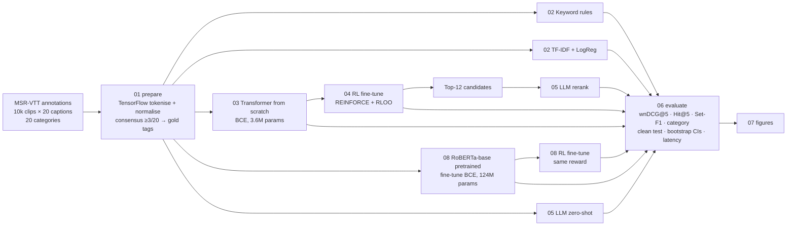

# 🎬 Caption-to-Hashtag: TensorFlow text pipeline + RoBERTa + RL + LLM rerank for video hashtags

**Given a one-sentence description of a video, generate the hashtags people would use for it, across 20 kinds of video (music, gaming, cooking, autos, news, beauty, ...).**

An end-to-end, CPU-only project. It covers:
- dataset choice, and weak-supervision labelling with a **TensorFlow text pipeline**;
- five trained models, from keyword rules to a **fine-tuned pretrained RoBERTa-base**;
- **reinforcement-learning fine-tuning on a set-level reward**;
- an **LLM stage** that reranks a model's candidates;
- a **leakage audit**, and a metric suite built for this data, with confidence intervals and an efficiency benchmark.

Every number below comes from scripts in this repo.

```text
"a chef slices onions and fries them in a pan"            (RoBERTa + RL)
  → #food  #kitchen  #onion  #chef  #dish  #vegetable  #pan
"a rock band is playing on stage"
  → #band  #stage  #performing  #music  #singing  #song  #rock  #concert
"two teams compete in a basketball game in front of a crowd"   (Transformer + RL, 1.3 ms)
  → #sports  #game  #player  #basketball  #ball
```

---

## TL;DR results

Test set: **2,990 clips**, one caption each. The primary metric is **wnDCG@5** (explained in §5); its ceiling is 1.0.

| Model | wnDCG@5 | Hit@5 | Set-F1 | Category top-1 / top-2 | Latency (CPU, 1 thread) | Size |
|---|---|---|---|---|---|---|
| Keyword rules (no learning) | 0.304 | 76.2% | 0.315 | 14.0% / 24.0% | 6.9 ms* | – |
| TF-IDF + logistic regression | 0.499 | 83.8% | 0.380 | 49.1% / 62.1% | 0.5 ms | 45 MB |
| Transformer from scratch (BCE) | 0.536 | 86.0% | 0.444 | 52.5% / 66.1% | 1.3 ms | 14 MB |
| Transformer from scratch + RL | 0.552 | 85.8% | 0.468 | 52.0% / 65.9% | 1.3 ms | 14 MB |
| RoBERTa-base fine-tuned (BCE) | 0.552 | **88.3%** | 0.471 | **54.7%** / **69.3%** | 77 ms | 474 MB |
| **RoBERTa-base fine-tuned + RL** | **0.555** | 87.2% | **0.485** | 53.9% / 68.3% | 77 ms | 474 MB |

\* The keyword baseline runs TensorFlow string ops eagerly, one caption per call, so its single-caption latency is dominated by framework overhead. Batched, it processes about 29k captions/s.

**Takeaways**
1. **Learning beats rules by a wide margin.** wnDCG@5 rises from 0.304 to 0.555 (+83%), and category accuracy from 14% to 54%: a caption rarely names its own category.
2. **RL is the most consistent gain.** Policy-gradient fine-tuning on a set-F1 reward raises Set-F1 by **+0.024 [95% CI +0.019, +0.030]** on the from-scratch Transformer and by **+0.014 [+0.008, +0.019]** on RoBERTa. It mainly teaches the model *how many* tags to emit; ranking quality (wnDCG@5) moves little.
3. **Pretraining helps, but RL closes most of the gap.** With BCE training, RoBERTa beats the from-scratch Transformer by +0.016 wnDCG@5 [+0.009, +0.024]. After RL on both, the gap in wnDCG@5 is not significant (+0.003 [−0.005, +0.010]). RoBERTa still wins on Set-F1 (+0.017 [+0.010, +0.024]) and category accuracy.
4. **The practical choice is the small model.** Transformer + RL reaches 99% of RoBERTa + RL's wnDCG@5 at **1.3 ms vs 77 ms** per caption (about 60× faster) and 14 MB vs 474 MB. RoBERTa is the quality ceiling and a natural distillation teacher (§9).
5. **No leakage found.** 0 test clips share a YouTube source with train/val. On a "clean" test without verbatim duplicate captions, every number holds (RoBERTa + RL: 0.555 → 0.556).
6. **The LLM is not a silver bullet.** On a 200-clip subset, neither LLM zero-shot nor LLM rerank significantly beats the fine-tuned models. The rerank uses 3.5× fewer prompt tokens than zero-shot and adds world knowledge the encoders lack (*"… a narrator mentions syria"* → `#news #war`).

<p align="center"></p>

---

## 1. Problem framing

Creators describe a video in one line. Platforms want **hashtags** for search, recommendation and reach. The difficulty is that **a caption doesn't spell out its hashtags**. "a man drives an audi through the countryside" should yield `#autos #car #driving #road`. A good tagger must infer the *category* and the *topic tags other viewers would use*, not just copy words.

**Task formulation:** multi-label prediction over **387 hashtags** (including 20 category tags). Input: one caption. Output: either a ranked list or a set whose size the model chooses.

## 2. Dataset: why MSR-VTT

| Candidate | Why / why not |
|---|---|
| **MSR-VTT** (Xu et al., CVPR 2016) ✅ | 10,000 YouTube clips × **20 human captions each** (200k sentences) × **20 video categories**. Standard splits, ~4 MB annotation file, widely cited. |
| YouTube-8M | Has topic labels, but no natural-language captions. |
| Scraped TikTok / Instagram hashtag dumps | Real hashtags, but noisy, spam-heavy, and unclear licensing. Hard to reproduce. |
| VATEX | Good alternative (41k clips with captions). Its labels are Kinetics *actions*, not video categories. |

Split: the standard **6,513 train / 497 validation / 2,990 test** clips.

### Labels from annotator consensus (weak supervision, TensorFlow text pipeline)

MSR-VTT has no hashtags, so the labels are built in `src/hashtagger/data.py` and `src/hashtagger/text.py`:

1. **Category hashtag:** the clip's category becomes `#music`, `#gaming`, `#autos`, `#howto`, and so on. Category names are reserved for this use, so `#cooking` means *this is a cooking video*.
2. **Topic hashtags.** Every caption is processed with TensorFlow:
   - `tf.strings` standardises and tokenises it.
   - Keras `TextVectorization` learns the corpus vocabulary from **training captions only**.
   - A `tf.lookup.StaticHashTable` merges plurals into the singular (`cars` → `car`, `puppies` → `puppy`, `dishes` → `dish`). A plural is merged only when its singular is itself a corpus word, and an exception list protects words like `news` and `glass`.
   - A second lookup table removes stop-words, generic words (`man`, `video`), visual-detail words (`shirt`, `chair`) and descriptive adjectives.
   - A term becomes a **gold tag if ≥ 3 of the 20 annotators independently mention it**.
3. The vocabulary is built from **training clips only**: 387 tags, about 4.1 gold tags per clip.

At test time the model sees **one** randomly chosen caption (fixed seed) and must predict the tags the **other** annotators agreed on. Only **33%** of the gold topic tags appear literally in that caption.

## 3. Pipeline



| Step | Script | Time (2 vCPU) |
|---|---|---|
| Build labels (TensorFlow) | `scripts/01_prepare_data.py` | 10 s |
| Baselines | `scripts/02_train_baselines.py` | 1.5 min |
| Transformer from scratch (BCE) | `scripts/03_train_transformer.py` | 24 min |
| RL on Transformer | `scripts/04_rl_finetune.py` | 8 min |
| LLM stages | `scripts/05_llm_hashtags.py --stage zero_shot / hybrid` | cached |
| Evaluate + benchmark | `scripts/06_evaluate.py` | 1 min |
| Figures | `scripts/07_make_figures.py` | 3 s |
| **RoBERTa-base fine-tune + RL** | `scripts/08_finetune_roberta.py [--resume]` | **61 + 8 min** |

## 4. Models

**0 · Keyword rules.** Hashtags are the vocabulary terms that literally appear in the caption (same TensorFlow term extractor as the labels), padded with the most popular tags. This is what a naive tool does.

**1 · TF-IDF + logistic regression.** Word 1–2-gram TF-IDF (30k features) feeding one linear layer with sigmoid outputs. Trained with Adagrad, with output biases initialised to the label prior.

**2 · Transformer from scratch.** Word tokenizer → 2-layer pre-LN encoder (d=192) → mean-pool → MLP → 387 logits. **3.6M parameters**, BCE, 6 epochs.

**3 · RoBERTa-base, fine-tuned.** This is the standard industry choice for text tagging. Production systems typically fine-tune a pretrained BERT-family encoder (BERT, RoBERTa, DistilBERT) or a sentence-embedding model (MiniLM, E5, BGE) with a multi-label head.

- **Architecture:** byte-BPE → RoBERTa-base (12 layers, 768-d, **124M parameters**, pretrained on 160 GB of English text) → masked mean-pool → dropout → linear → 387 logits.
- **Training:** all weights are fine-tuned with AdamW (encoder learning rate 3e-5, head 1e-3), 6% warm-up, linear decay, batch 32, dynamic padding, 2 epochs.
- **Data sampling:** each epoch **re-samples 4 of the 20 captions** per training clip.
- **Model selection:** checkpoints are chosen on validation F1@5 only.
- **Where the weights come from:** `roberta.source: hf` loads Hugging Face `roberta-base`. The default `spacy` source loads the **same RoBERTa-base weights** packaged in spaCy's `en_core_web_trf` (GitHub releases), which was used here because the build machine could not reach Hugging Face.
- **Resumable training:** the full training state (weights, optimizer, scheduler, position in the data) is saved every 200 steps with atomic writes; `--resume` continues exactly where it stopped.

**RL fine-tuning (applied to both the Transformer and RoBERTa).** The model is treated as a **policy** over tag sets, π(S | caption) = ∏ⱼ Bernoulli(sⱼ; σ(zⱼ)):

```
sample   K = 4 tag-sets  S₁..S₄ ~ π(· | caption)
reward   r(S) = F1(S, gold)                      ← any black-box reward plugs in here
baseline bᵢ = mean_{k≠i} r(S_k)                   ← RLOO (Ahmadian et al., 2024)
loss     −(rᵢ − bᵢ) · log π(Sᵢ)  +  0.5 · BCE     ← supervised anchor, like the SFT/KL anchor in RLHF
decode   greedy:  sⱼ = 1  iff  pⱼ ≥ 0.5
```

*Why RL?* BCE optimises each tag independently, so it never learns *how many* tags to emit or which tags belong *together*. Set-F1 is non-differentiable, so policy gradients optimise it directly. The leave-one-out baseline needs no critic, which is the same design choice as RLOO / GRPO in LLM RLHF. The reward function is the extension point: an LLM-judge score (RLAIF) or click-through data can drop in without changing the loop.

<p align="center"></p>

**LLM zero-shot.** The LLM gets the caption plus the full allowed-tag list (~920 prompt tokens) and returns 5 tags as JSON.

**LLM rerank (hybrid).** The Transformer + RL model proposes its **top-12 candidates with confidences** (~260 prompt tokens). The LLM picks the best 5, may add one missed tag, and suggests up to 2 creative tags, which are not scored. A validator keeps exactly one category tag; LLMs routinely answer `#food` + `#cooking`. The client supports **Anthropic, OpenAI, Ollama and vLLM**, and caches every response in `data/llm_cache/` so results reproduce without an API key.

## 5. Evaluation: why not just F1@5

F1@5 is a poor fit for this data, for three reasons:
- **Its ceiling is not 1.0.** Clips have 1–10 gold tags, so even a perfect oracle scores only about F1@5 = 0.79. A clip with a single gold tag caps at 0.33.
- **It treats every tag as equally relevant.** A tag that 18 of 20 annotators mention counts the same as one that only 3 mention.
- **It uses exact match.** `#movie` vs `#film` counts as a miss, and so does any reasonable tag outside the gold set.

So the evaluation (`src/hashtagger/metrics.py`) uses:

| Metric | What it measures |
|---|---|
| **wnDCG@5** (primary) | nDCG where each gold tag's gain = **the share of the clip's *other* 19 captions that mention it**; the category tag gets gain 1. The input caption is excluded, so copying it earns nothing. Normalised per clip: **ceiling 1.0**. |
| nDCG@5 | The same, with binary relevance. |
| wRecall@5 | Share of annotator "votes" covered by the top 5. |
| Hit@5 | Share of clips with ≥ 1 correct tag in the top 5: the user-facing view. |
| Set-F1 | F1 of the tag set the model chooses to emit (threshold 0.5, or a threshold tuned on validation). |
| Category top-1 / top-2 / macro-F1 | Top-2 is included because MSR-VTT categories overlap (cooking vs food, movies vs tvshow); macro-F1 is included because categories are imbalanced. |
| Paired bootstrap 95% CI | 5,000 resamples for every claimed improvement. |

Still missing: **LLM-as-judge or human ratings** (per-tag relevance, pairwise win-rate) and **online metrics** (tag acceptance rate, reach). These are the only ways to score tags that are valid but absent from the gold set.

## 6. Leakage audit

| Check | Result |
|---|---|
| Test clips cut from the same **YouTube source video** as a train/val clip | **0 / 2,990** (the standard split is source-disjoint) |
| Label vocabulary, plural table, label prior, TF-IDF vocabulary, word tokenizer | Built from **train only**. RoBERTa uses its frozen pretrained tokenizer. |
| Checkpoint selection, decision thresholds, RL monitoring | **Validation only.** The test set is predicted once, after training. |
| Metric gains | Computed from the **other 19 captions**. The input caption never contributes. |
| LLM stages | The LLM saw only the caption (and the model's candidates). Never the gold labels. |
| Input caption appears **verbatim** in training captions | **348 clips (11.6%)**. These are generic sentences such as *"a person is explaining something"* that describe different videos, so no test label leaks. Results are also reported on the **clean test** (2,642 clips) without them. |
| Pretraining data | RoBERTa's 2019 web/books corpus. MSR-VTT annotations are not a known part of it. |

**Clean test (2,642 clips)**

| Model | wnDCG@5 | F1@5 | Hit@5 | Category top-1 |
|---|---|---|---|---|
| TF-IDF + LogReg | 0.492 | 0.397 | 83.6% | 48.5% |
| Transformer from scratch + RL | 0.549 | 0.435 | 85.8% | 51.8% |
| RoBERTa-base (BCE) | 0.552 | 0.459 | 88.8% | 55.0% |
| **RoBERTa-base + RL** | **0.556** | 0.454 | 87.6% | 54.0% |

## 7. Results in detail

Full tables: [`results/results.md`](results/results.md). Raw numbers: [`results/metrics.json`](results/metrics.json).

### Significance (paired bootstrap, 5,000 resamples)

| Comparison | Δ | 95% CI |
|---|---|---|
| RoBERTa-BCE vs Transformer-BCE (wnDCG@5) | +0.016 | [+0.009, +0.024] |
| RoBERTa+RL vs Transformer+RL (wnDCG@5) | +0.003 | [−0.005, +0.010] (n.s.) |
| RoBERTa+RL vs Transformer+RL (Set-F1) | +0.017 | [+0.010, +0.024] |
| RoBERTa+RL vs RoBERTa-BCE (Set-F1) | +0.014 | [+0.008, +0.019] |
| RoBERTa+RL vs RoBERTa-BCE (wnDCG@5) | +0.003 | [−0.001, +0.007] (n.s.) |
| Transformer+RL vs Transformer-BCE (Set-F1) | +0.024 | [+0.019, +0.030] |
| LLM rerank vs Transformer+RL (wnDCG@5, subset) | −0.014 | [−0.053, +0.024] (n.s.) |
| LLM rerank vs Transformer+RL (F1@5, subset) | +0.013 | [−0.010, +0.036] (n.s.) |
| RoBERTa+RL vs LLM rerank (wnDCG@5, subset) | +0.023 | [−0.015, +0.062] (n.s.) |

### LLM comparison (fixed random subset of 200 test clips)

<p align="center"></p>

| Model | wnDCG@5 | F1@5 | Set-F1 | Prompt tokens |
|---|---|---|---|---|
| Transformer + RL | 0.563 | 0.428 | 0.453 | 0 |
| RoBERTa + RL | **0.571** | 0.439 | **0.466** | 0 |
| LLM zero-shot | 0.511 | 0.401 | 0.411 | ~921 |
| Transformer + RL → LLM rerank | 0.548 | **0.441** | 0.441 | ~262 |

The LLM tends to choose **specific** tags (`#chicken`, `#frying`), where the models choose **high-agreement** tags (`#food`, `#dish`). Exact-match F1 slightly favours the first; agreement-weighted wnDCG favours the second. None of the LLM differences is significant on 200 clips. The LLM's clearest contribution is world knowledge. For *"a helicopter flies over rooftops while gunfire is heard and a narrator mentions syria"*, only the LLM rerank produced `#news #war`.

### Per kind of video

<p align="center"></p>

Concrete, visual categories (`#autos`, `#animals`, `#food`, `#howto`, `#sports`, `#gaming`) reach wnDCG@5 ≈ 0.65–0.74. Categories defined by *format* rather than content (`#ads`, `#tvshow`, `#documentary`, `#people`) stay below 0.3: an ad for a car is described as a car. Pretraining helps most on `#howto`, `#animals` and `#food`; it loses ground on `#scitech`, `#education` and `#music`.

### Efficiency

<p align="center"></p>

| Model | p50 latency | Throughput (batched) | Size | Params | Train time (2 vCPU) |
|---|---|---|---|---|---|
| Keyword rules | 6.9 ms* | 29k/s | – | – | – |
| TF-IDF + LogReg | 0.48 ms | 28k/s | 45 MB | 11.6M | 1.4 min |
| Transformer from scratch + RL | 1.3 ms | 1.8k/s | 14 MB | 3.6M | 32 min |
| RoBERTa-base + RL | 77 ms | 46/s | 474 MB | 124.4M | 69 min |
| LLM rerank | one LLM call | – | – | – | ~262 input / 26 output tokens |

All latencies are measured on **one CPU thread** (\*eager TensorFlow overhead; see the TL;DR note). RoBERTa would run in a few ms on a GPU, or with ONNX/int8 quantisation, but the comparison above is like-for-like.

### Examples (test set)

| Caption (model input) | Gold (other annotators) | Transformer + RL | RoBERTa + RL | LLM rerank |
|---|---|---|---|---|
| *a rock band is playing on stage* | band concert crowd music perform performing rock song stage | band music performing stage song singing concert | band stage performing music singing song rock concert guitar | music band rock stage concert |
| *a soup is been prepared and its been kept in the cup* | bowl dish food pot recipe soup spoon | food soup dish kitchen bowl ingredient fish | food soup dish pot bowl kitchen | food soup bowl dish pot |
| *a man is interviewing stephen hawking with a laugh track in the background* | interview interviewing tvshow | sports track news race ❌ | interview interviewed news interviewing | scitech interview interviewed laughing track |
| *a helicopter flies over rooftops while gunfire is heard and a narrator mentions syria* | fighting flying news war | flying fly travel | movies plane movie | news flying sky war air |

The third row shows pretraining at work. The from-scratch model reads "laugh *track*" as a race track; RoBERTa doesn't. The fourth row shows the LLM's world knowledge.

## 8. Lessons learned (debugging notes)

- **TensorFlow and PyTorch's Triton can't share a process.** With TensorFlow and the CUDA build of PyTorch in one Python process, PyTorch lazily imports Triton (its GPU compiler) when an optimizer is created. Both libraries register the same LLVM options, so the process aborts with `LLVM ERROR: inconsistency in registered CommandLine options`. On a CPU-only machine the fix is to remove Triton (`pip uninstall triton`), or to install the CPU build of PyTorch, which ships without it.
- **Weight decay plus an adaptive optimiser silently broke the linear baseline.** With Adam or Adagrad, an L2 term added to the gradient gets *normalised per coordinate*. For a sparse n-gram absent from a batch, even `1e-6` decay becomes a full-size step toward zero. Setting `weight_decay=0` lifted validation F1@5 from 0.27 to 0.39.
- **Without a POS tagger, the stop-list does the work.** The first TensorFlow vocabulary contained adjectives and names (`older`, `female`, `ready`, `david`) that a part-of-speech filter used to drop. Reviewing the vocabulary and extending the stop-list fixed it.
- **Label namespaces matter.** Category names doubled as topic tags at first, which blurred the category signal. Reserving them fixed it.
- **Pick the metric before reading the leaderboard.** F1@5 and wnDCG@5 can disagree about the LLM rerank (§7).
- **Make long training runs resumable, with atomic checkpoints.** A smoke test that killed the process mid-save produced a corrupted 380 MB file. Writing to a temp file followed by `os.replace` fixed it.

## 9. Honest limitations & next steps

**Limitations**
- **LLM numbers come from 200 clips**, so their confidence intervals are wide. **The LLM outputs in `data/llm_cache/` were produced by Claude (`claude-opus-5-5`) answering the exact prompts in `src/hashtagger/llm/prompts.py`.** They were recorded through the script's batch `--export-pending` / `--import-answers` workflow, because the build machine had no API access. Token counts are therefore estimated (~4 characters per token) and LLM latency was not measured. Re-run with `--provider anthropic` (or `openai` / `ollama`) to replace them.
- **The labels now come from a TensorFlow pipeline** (an earlier version used NLTK part-of-speech tagging and lemmatisation; see the git history). Without lemmatisation, verb forms stay separate (`cook`, `cooking`), so the label set differs and numbers are not directly comparable across the two versions.
- **Labels are weak supervision** (annotator consensus): they capture what people *see*, not what is *trending*.
- **The models are text-only.** The RoBERTa checkpoint (474 MB) is not committed because it exceeds GitHub's 100 MB limit; `make roberta` reproduces it.

**Next steps**
- **Distillation:** train the 14 MB Transformer on RoBERTa + RL soft labels to keep its Set-F1 and category accuracy at 1 ms.
- **RLAIF:** use an LLM judge as the reward in the RL loop, and report LLM-judge win-rates as an evaluation metric.
- **LLM rerank on RoBERTa candidates**, and a larger LLM evaluation subset.
- **Multimodal:** add CLIP frame embeddings alongside the caption encoder.

---

## Repository layout

```text
video-hashtag-llm/
├── README.md
├── LICENSE
├── Makefile                      # make all | data | baselines | transformer | rl | roberta [RESUME=1] | llm | eval | figures | test | demo
├── requirements.txt
├── configs/
│   └── default.yaml              # every hyper-parameter in one place
├── scripts/
│   ├── download_data.sh          # MSR-VTT annotations (~4 MB)
│   ├── 01_prepare_data.py        # consensus labels → data/processed/
│   ├── 02_train_baselines.py     # keyword rules, TF-IDF + LogReg
│   ├── 03_train_transformer.py   # from-scratch Transformer (BCE)
│   ├── 04_rl_finetune.py         # REINFORCE + RLOO on set-F1 (Transformer)
│   ├── 05_llm_hashtags.py        # LLM zero-shot / rerank (live, cached or batch import)
│   ├── 06_evaluate.py            # metric suite, clean test, bootstrap CIs, latency/size
│   ├── 07_make_figures.py
│   └── 08_finetune_roberta.py    # pretrained RoBERTa-base: BCE fine-tune + RL, resumable
├── src/hashtagger/
│   ├── data.py                   # loading, split, weak-supervision labels, metric gains
│   ├── text.py                   # TensorFlow text pipeline: tf.strings, TextVectorization, tf.lookup
│   ├── metrics.py                # wnDCG / nDCG / wRecall / Hit@k, P/R/F1@k, Set-F1, category suite
│   ├── predict.py                # Hashtagger inference API (RoBERTa or Transformer)
│   ├── utils.py
│   ├── models/
│   │   ├── common.py             # label space, top-k / threshold decoding, threshold tuning
│   │   ├── keyword.py
│   │   ├── tfidf_linear.py
│   │   ├── transformer.py
│   │   ├── pretrained.py         # RoBERTa-base backbone (HF or spaCy weights) + tagging head
│   │   └── rl.py                 # policy-gradient fine-tuning
│   └── llm/
│       ├── client.py             # Anthropic / OpenAI / Ollama + response cache + validators
│       └── prompts.py
├── demo/
│   ├── cli.py                    # python demo/cli.py "your caption" [--tagger roberta] [--llm anthropic]
│   └── app.py                    # Gradio web UI
├── tests/
│   └── test_core.py              # metrics, RL reward, decoding, LLM parsing
├── checkpoints/
│   └── transformer_rl.pt         # 14 MB model shipped for the demo (RoBERTa: run `make roberta`)
├── data/
│   └── llm_cache/                # cached LLM responses (zero_shot.jsonl, hybrid.jsonl)
└── results/
    ├── metrics.json  results.md  dataset_stats.json
    ├── train_log_*.json  llm_*_usage.json  llm_subset_ids.json
    ├── preds/llm_*_test_subset.json
    └── figures/*.png
```

## Quickstart

```bash
git clone https://github.com/<you>/video-hashtag-llm && cd video-hashtag-llm
python -m venv .venv && source .venv/bin/activate
pip install torch --index-url https://download.pytorch.org/whl/cpu   # CPU build (no Triton → no LLVM clash with TensorFlow)
pip install -r requirements.txt

# Try the shipped 14 MB model right away
python demo/cli.py "a woman applies eye makeup in front of a mirror"
python demo/app.py                      # http://localhost:7860

# Reproduce everything (~2 h on a 2-core CPU; much faster on a GPU)
make all
make roberta RESUME=1                   # continue an interrupted RoBERTa run
make test

# Re-run the LLM stages live
export ANTHROPIC_API_KEY=...            # or OPENAI_API_KEY / a local Ollama server
python scripts/05_llm_hashtags.py --stage hybrid --provider anthropic --model claude-opus-5-5
```

## References

- J. Xu, T. Mei, T. Yao, Y. Rui. *MSR-VTT: A Large Video Description Dataset for Bridging Video and Language.* CVPR 2016.
- Y. Liu et al. *RoBERTa: A Robustly Optimized BERT Pretraining Approach.* arXiv:1907.11692, 2019.
- S. Rennie et al. *Self-critical Sequence Training for Image Captioning.* CVPR 2017.
- A. Ahmadian et al. *Back to Basics: Revisiting REINFORCE-Style Optimization for Learning from Human Feedback in LLMs.* ACL 2024.
- K. Järvelin, J. Kekäläinen. *Cumulated gain-based evaluation of IR techniques.* ACM TOIS, 2002.
