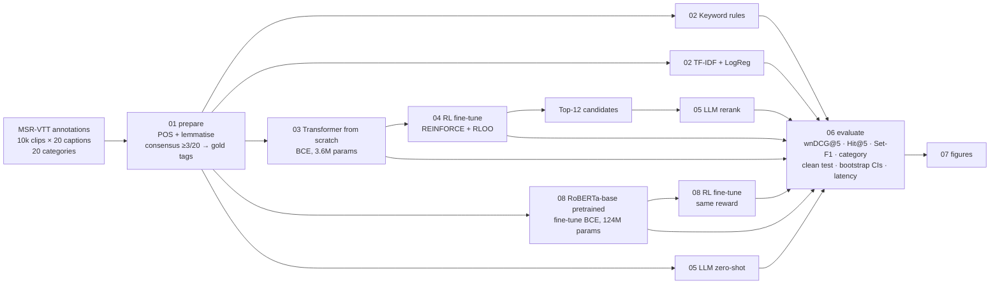

# 🎬 Caption-to-Hashtag: fine-tuned RoBERTa + RL + LLM rerank for video hashtags

**Given a one-sentence description of a video, generate the hashtags people would use for it, across 20 kinds of video (music, gaming, cooking, autos, news, beauty, ...).**

An end-to-end, CPU-only project. It covers:
- dataset choice and weak-supervision labelling;
- five trained models, from keyword rules to a **fine-tuned pretrained RoBERTa-base**;
- **reinforcement-learning fine-tuning on a set-level reward**;
- an **LLM stage** that reranks a model's candidates;
- a **leakage audit**, and a metric suite built for this data, with confidence intervals and an efficiency benchmark.

Every number below comes from scripts in this repo.

```text
"a chef slices onions and fries them in a pan"            (RoBERTa + RL)
  → #food  #onion  #kitchen  #dish  #preparing  #chef  #pan  #vegetable
"a rock band is playing on stage"
  → #band  #stage  #performing  #music  #singing  #song  #guitar  #rock
```

---

## TL;DR results

Test set: **2,990 clips**, one caption each. The primary metric is **wnDCG@5** (explained in §5); its ceiling is 1.0.

| Model | wnDCG@5 | Hit@5 | Set-F1 | Category top-1 / top-2 | Latency (CPU, 1 thread) | Size |
|---|---|---|---|---|---|---|
| Keyword rules (no learning) | 0.302 | 76.2% | 0.321 | 14.1% / 24.2% | 0.2 ms | – |
| TF-IDF + logistic regression | 0.501 | 84.2% | 0.383 | 49.1% / 62.1% | 0.6 ms | 43 MB |
| Transformer from scratch (BCE) | 0.537 | 86.3% | 0.441 | 51.7% / 65.5% | 2.4 ms | 14 MB |
| Transformer from scratch + RL | 0.551 | 85.7% | 0.466 | 51.5% / 65.3% | 2.0 ms | 14 MB |
| RoBERTa-base fine-tuned (BCE) | 0.559 | **88.8%** | 0.472 | **54.7%** / 69.2% | 113 ms | 474 MB |
| **RoBERTa-base fine-tuned + RL** | **0.565** | 88.2% | **0.489** | 54.6% / **69.4%** | 113 ms | 474 MB |

**Takeaways**
1. **Pretraining is the largest single gain among learned models.** Fine-tuned RoBERTa-base beats the Transformer trained from scratch by **+0.022 wnDCG@5 [95% CI +0.014, +0.029]**, and lifts category accuracy by about 3 points. This is the industry-standard recipe for text tagging, and it holds here.
2. **RL helps on top of a strong pretrained model.** Policy-gradient fine-tuning on a set-F1 reward adds **+0.017 Set-F1 [+0.011, +0.022]** and **+0.007 wnDCG@5 [+0.003, +0.011]** to RoBERTa. The same recipe gave +0.025 Set-F1 on the from-scratch model.
3. **No leakage found.** 0 test clips share a YouTube source with train/val. On a "clean" test that removes the 11.6% of clips whose input caption appears verbatim in training, every number holds (RoBERTa + RL: 0.565 → 0.565).
4. **The choice of metric changes conclusions about the LLM.** On a 200-clip subset, the LLM rerank looks better by F1@5 (+0.022, significant). By the agreement-weighted wnDCG@5 it is no better (−0.010, CI [−0.047, +0.027]), and **RoBERTa + RL beats it by +0.046 [+0.007, +0.085]**.
5. **The cost is latency.** RoBERTa is about 50× slower than the 14 MB Transformer on one CPU thread (113 ms vs 2 ms). The natural next step is distilling it into the small model (§9).

<p align="center"></p>

---

## 1. Problem framing

Creators describe a video in one line. Platforms want **hashtags** for search, recommendation and reach. The difficulty is that **a caption doesn't spell out its hashtags**. "a man drives an audi through the countryside" should yield `#autos #car #driving #road`. A good tagger must infer the *category* and the *topic tags other viewers would use*, not just copy words.

**Task formulation:** multi-label prediction over 367 hashtags (including 20 category tags). Input: one caption. Output: either a ranked list or a set whose size the model chooses.

## 2. Dataset: why MSR-VTT

| Candidate | Why / why not |
|---|---|
| **MSR-VTT** (Xu et al., CVPR 2016) ✅ | 10,000 YouTube clips × **20 human captions each** (200k sentences) × **20 video categories**. Standard splits, ~4 MB annotation file, widely cited. |
| YouTube-8M | Has topic labels, but no natural-language captions. |
| Scraped TikTok / Instagram hashtag dumps | Real hashtags, but noisy, spam-heavy, and unclear licensing. Hard to reproduce. |
| VATEX | Good alternative (41k clips with captions). Its labels are Kinetics *actions*, not video categories. |

Split: the standard **6,513 train / 497 validation / 2,990 test** clips.

### Labels from annotator consensus (weak supervision)

MSR-VTT has no hashtags, so the labels are built in `src/hashtagger/data.py`:

1. **Category hashtag:** the clip's category becomes `#music`, `#gaming`, `#autos`, `#howto`, and so on. Category names are reserved for this use, so `#cooking` means *this is a cooking video*.
2. **Topic hashtags:** each caption is POS-tagged and lemmatised. Nouns are made singular (`cars` → `car`) and verbs become their gerund (`sings` → `singing`). A term becomes a **gold tag if ≥ 3 of the 20 annotators independently mention it**. Generic words (`man`, `video`) and visual-detail words (`shirt`, `chair`) are filtered out.
3. The vocabulary is built from **training clips only**. Clips average 4.1 gold tags.

At test time the model sees **one** randomly chosen caption (fixed seed) and must predict the tags the **other** annotators agreed on.

## 3. Pipeline



| Step | Script | Time (2 vCPU) |
|---|---|---|
| Build labels | `scripts/01_prepare_data.py` | 40 s |
| Baselines | `scripts/02_train_baselines.py` | 1.5 min |
| Transformer from scratch (BCE) | `scripts/03_train_transformer.py` | 24 min |
| RL on Transformer | `scripts/04_rl_finetune.py` | 8 min |
| LLM stages | `scripts/05_llm_hashtags.py --stage zero_shot / hybrid` | cached |
| Evaluate + benchmark | `scripts/06_evaluate.py` | 35 s |
| Figures | `scripts/07_make_figures.py` | 3 s |
| **RoBERTa-base fine-tune + RL** | `scripts/08_finetune_roberta.py [--resume]` | **79 + 11 min** |

## 4. Models

**0 · Keyword rules.** Hashtags are the vocabulary terms that literally appear in the caption, padded with the most popular tags. This is what a naive tool does.

**1 · TF-IDF + logistic regression.** Word 1–2-gram TF-IDF (30k features) feeding one linear layer with sigmoid outputs. Trained with Adagrad, with output biases initialised to the label prior.

**2 · Transformer from scratch.** Word tokenizer → 2-layer pre-LN encoder (d=192) → mean-pool → MLP → 367 logits. **3.6M parameters**, BCE, 6 epochs.

**3 · RoBERTa-base, fine-tuned.** This is the standard industry choice for text tagging. Production systems typically fine-tune a pretrained BERT-family encoder (BERT, RoBERTa, DistilBERT) or a sentence-embedding model (MiniLM, E5, BGE) with a multi-label head. Fully multimodal video taggers add a vision encoder such as CLIP; see §9.

- **Architecture:** byte-BPE → RoBERTa-base (12 layers, 768-d, **124M parameters**, pretrained on 160 GB of English text) → masked mean-pool → dropout → linear → 367 logits.
- **Training:** all weights are fine-tuned with AdamW (encoder learning rate 3e-5, head 1e-3), 6% warm-up, linear decay, batch 32, dynamic padding, 2 epochs.
- **Data sampling:** each epoch **re-samples 4 of the 20 captions** per training clip, so the model sees 8 distinct captions per clip in total.
- **Model selection:** checkpoints are chosen on validation F1@5 only.
- **Where the weights come from:** `roberta.source: hf` loads Hugging Face `roberta-base`. The build machine could not reach Hugging Face, so the default `spacy` source loads the **same RoBERTa-base weights** packaged in spaCy's `en_core_web_trf`, which is hosted on GitHub releases (`src/hashtagger/models/pretrained.py`).
- **Resumable training:** the full training state (weights, optimizer, scheduler, position in the data) is saved every 200 steps with **atomic writes**, so a kill mid-save cannot corrupt it. `--resume` continues exactly where it stopped. The reported run was paused once after epoch 1. Epoch 2 resumed from the epoch-1 weights with the learning-rate schedule fast-forwarded, but with fresh AdamW moments, because the exact-resume feature was added during that pause (`results/roberta_resume.json`).

**RL fine-tuning (applied to both the Transformer and RoBERTa).** The model is treated as a **policy** over tag sets, π(S | caption) = ∏ⱼ Bernoulli(sⱼ; σ(zⱼ)):

```
sample   K = 4 tag-sets  S₁..S₄ ~ π(· | caption)
reward   r(S) = F1(S, gold)                      ← any black-box reward plugs in here
baseline bᵢ = mean_{k≠i} r(S_k)                   ← RLOO (Ahmadian et al., 2024)
loss     −(rᵢ − bᵢ) · log π(Sᵢ)  +  0.5 · BCE     ← supervised anchor, like the SFT/KL anchor in RLHF
decode   greedy:  sⱼ = 1  iff  pⱼ ≥ 0.5
```

*Why RL?* BCE optimises each tag independently, so it never learns *how many* tags to emit or which tags belong *together*. Set-F1 is non-differentiable, so policy gradients optimise it directly. The leave-one-out baseline needs no critic, which is the same design choice as RLOO / GRPO in LLM RLHF. The reward function is the extension point: an LLM-judge score (RLAIF) or click-through data can drop in without changing the loop.

<p align="center"></p>

**LLM zero-shot.** The LLM gets the caption plus the full allowed-tag list (~900 prompt tokens) and returns 5 tags as JSON.

**LLM rerank (hybrid).** The Transformer + RL model proposes its **top-12 candidates with confidences** (~260 prompt tokens). The LLM picks the best 5, may add one missed tag, and suggests up to 2 creative tags, which are not scored. A validator keeps exactly one category tag. The client supports **Anthropic, OpenAI, Ollama and vLLM**, and caches every response in `data/llm_cache/` so results reproduce without an API key.

## 5. Evaluation: why not just F1@5

F1@5 is a poor fit for this data, for three reasons:
- **Its ceiling is not 1.0.** Clips have 1–10 gold tags, so even a perfect oracle scores only F1@5 = 0.79. A clip with a single gold tag caps at 0.33.
- **It treats every tag as equally relevant.** A tag that 18 of 20 annotators mention counts the same as one that only 3 mention.
- **It uses exact match.** `#movie` vs `#film` counts as a miss, and so does any reasonable tag outside the gold set.

So the evaluation (`src/hashtagger/metrics.py`) uses:

| Metric | What it measures |
|---|---|
| **wnDCG@5** (primary) | nDCG where each gold tag's gain = **the share of the clip's *other* 19 captions that mention it**; the category tag gets gain 1. The input caption is excluded, so copying it earns nothing. Normalised per clip: **ceiling 1.0**. |
| nDCG@5 | The same, with binary relevance. |
| wRecall@5 | Share of annotator "votes" covered by the top 5. |
| Hit@5 | Share of clips with ≥ 1 correct tag in the top 5: the user-facing view. |
| Set-F1 | F1 of the tag set the model chooses to emit (threshold 0.5, or a threshold tuned on validation). |
| Category top-1 / top-2 / macro-F1 | Top-2 is included because MSR-VTT categories overlap (cooking vs food, movies vs tvshow); macro-F1 is included because categories are imbalanced. |
| Paired bootstrap 95% CI | 5,000 resamples for every claimed improvement. |

Still missing: **LLM-as-judge or human ratings** (per-tag relevance, pairwise win-rate) and **online metrics** (tag acceptance rate, reach). These are the only ways to score tags that are valid but absent from the gold set.

## 6. Leakage audit

| Check | Result |
|---|---|
| Test clips cut from the same **YouTube source video** as a train/val clip | **0 / 2,990** (the standard split is source-disjoint) |
| Label vocabulary, label prior, TF-IDF vocabulary, word tokenizer | Built from **train only**. RoBERTa uses its frozen pretrained tokenizer. |
| Checkpoint selection, decision thresholds, RL monitoring | **Validation only.** The test set is predicted once, after training. |
| Metric gains | Computed from the **other 19 captions**. The input caption never contributes. |
| LLM stages | The LLM saw only the caption (and the model's candidates). Never the gold labels. |
| Input caption appears **verbatim** in training captions | **348 clips (11.6%)**. These are generic sentences such as *"a person is explaining something"* that describe different videos, so no test label leaks. Results are also reported on the **clean test** (2,642 clips) without them. |
| Pretraining data | RoBERTa's 2019 web/books corpus. MSR-VTT annotations are not a known part of it. |

**Clean test (2,642 clips)**

| Model | wnDCG@5 | F1@5 | Hit@5 | Category top-1 |
|---|---|---|---|---|
| TF-IDF + LogReg | 0.493 | 0.399 | 84.0% | 48.5% |
| Transformer from scratch + RL | 0.548 | 0.436 | 85.7% | 51.2% |
| RoBERTa-base (BCE) | 0.558 | 0.465 | 89.2% | 55.0% |
| **RoBERTa-base + RL** | **0.565** | 0.460 | 88.6% | 54.8% |

## 7. Results in detail

Full tables: [`results/results.md`](results/results.md). Raw numbers: [`results/metrics.json`](results/metrics.json).

### Significance (paired bootstrap, 5,000 resamples)

| Comparison | Δ | 95% CI |
|---|---|---|
| RoBERTa-BCE vs Transformer-BCE (wnDCG@5) | +0.022 | [+0.014, +0.029] |
| RoBERTa+RL vs RoBERTa-BCE (Set-F1) | +0.017 | [+0.011, +0.022] |
| RoBERTa+RL vs RoBERTa-BCE (wnDCG@5) | +0.007 | [+0.003, +0.011] |
| Transformer+RL vs Transformer-BCE (Set-F1) | +0.025 | [+0.019, +0.030] |
| LLM rerank vs Transformer+RL (F1@5, subset) | +0.022 | [+0.001, +0.045] |
| LLM rerank vs Transformer+RL (wnDCG@5, subset) | −0.010 | [−0.047, +0.027] (n.s.) |
| RoBERTa+RL vs LLM rerank (wnDCG@5, subset) | +0.046 | [+0.007, +0.085] |

### LLM comparison (fixed random subset of 200 test clips)

<p align="center"></p>

The LLM tends to choose **specific** tags (`#chicken`, `#frying`), where the models choose **high-agreement** tags (`#food`, `#dish`). Exact-match F1 rewards the first; agreement-weighted wnDCG rewards the second. Which one users prefer is exactly what an LLM-judge or online test would decide. The LLM still contributes world knowledge the encoders lack: for *"a helicopter flies over rooftops while gunfire is heard and a narrator mentions syria"*, only the LLM rerank produced `#news #war`.

### Per kind of video

<p align="center"></p>

Concrete, visual categories (`#autos`, `#animals`, `#sports`, `#gaming`) reach wnDCG@5 ≈ 0.67–0.72. Categories defined by *format* rather than content (`#ads`, `#tvshow`, `#documentary`, `#people`) stay below 0.3: an ad for a car is described as a car. Pretraining helps most on `#animals`, `#news` and `#education`, where world knowledge matters. It loses a little ground on `#cooking`, `#scitech` and `#music`.

### Efficiency

<p align="center"></p>

| Model | p50 latency | Throughput (batched) | Size | Params | Train time (2 vCPU) |
|---|---|---|---|---|---|
| Keyword rules | 0.19 ms | 5.8k/s | – | – | – |
| TF-IDF + LogReg | 0.60 ms | 21k/s | 43 MB | 11.0M | 1.5 min |
| Transformer from scratch + RL | 2.0 ms | 1.2k/s | 14 MB | 3.6M | 32 min |
| RoBERTa-base + RL | 113 ms | 32/s | 474 MB | 124.3M | 90 min |
| LLM rerank | one LLM call | – | – | – | ~263 input / 26 output tokens |

All latencies are measured on **one CPU thread**. RoBERTa would run in a few ms on a GPU, or with ONNX/int8 quantisation, but the comparison above is like-for-like.

### Examples (test set)

| Caption (model input) | Gold (other annotators) | Transformer + RL | RoBERTa + RL | LLM rerank |
|---|---|---|---|---|
| *a rock band is playing on stage* | band concert crowd music performing rock song stage | band music performing stage singing song concert | band stage performing music singing song guitar rock | music band rock stage concert |
| *a soup is been prepared and its been kept in the cup* | bowl dish food pot recipe serving soup spoon | food soup bowl preparing dish cooking kitchen | food soup pot bowl preparing dish kitchen | cooking soup bowl preparing dish |
| *a man is interviewing stephen hawking with a laugh track in the background* | interviewing tvshow | track sports race ❌ | interviewing interview news | scitech interviewing interview science laughing |
| *a helicopter flies over rooftops while gunfire is heard and a narrator mentions syria* | fighting flying news shooting war | flying travel sky plane air | flying | news flying war plane sky |

The third row shows pretraining at work. The from-scratch model reads "laugh *track*" as a race track; RoBERTa doesn't.

## 8. Lessons learned (debugging notes)

- **Weight decay plus an adaptive optimiser silently broke the linear baseline.** With Adam or Adagrad, an L2 term added to the gradient gets *normalised per coordinate*. For a sparse n-gram absent from a batch, even `1e-6` decay becomes a full-size step toward zero. The model gave *"a dog is running"* a 12% chance of `#dog`, against a 92% empirical rate. Setting `weight_decay=0` lifted validation F1@5 from 0.27 to 0.39.
- **Label namespaces matter.** Category names doubled as topic tags at first, which blurred the category signal. Reserving them fixed it.
- **Pick the metric before reading the leaderboard.** F1@5 and wnDCG@5 disagree about the LLM rerank (§7).
- **Make long training runs resumable, with atomic checkpoints.** A smoke test that killed the process mid-save produced a corrupted 380 MB file. Writing to a temp file followed by `os.replace` fixed it.
- **Initialise output biases to the label prior.** With 367 labels and ~1% positives, starting at p = 0.5 wastes the first epoch.

## 9. Honest limitations & next steps

**Limitations**
- **LLM numbers come from 200 clips**, so their confidence intervals are wide. **The LLM outputs in `data/llm_cache/` were produced by Claude (`claude-opus-5-5`) answering the exact prompts in `src/hashtagger/llm/prompts.py`.** They were recorded through the script's batch `--export-pending` / `--import-answers` workflow, because the build machine had no API access. Token counts are therefore estimated (~4 characters per token) and LLM latency was not measured. Re-run with `--provider anthropic` (or `openai` / `ollama`) to replace them.
- **The LLM rerank still uses the Transformer + RL candidates.** Re-running it on RoBERTa + RL candidates is the obvious next experiment.
- **Labels are weak supervision** (annotator consensus): they capture what people *see*, not what is *trending*.
- **The models are text-only.** The RoBERTa checkpoint (474 MB) is not committed because it exceeds GitHub's 100 MB limit; `make roberta` reproduces it.

**Next steps**
- **Distillation:** train the 14 MB Transformer on RoBERTa + RL (and LLM-rerank) soft labels, to keep most of the quality at 2 ms.
- **RLAIF:** use an LLM judge as the reward in the RL loop, and report LLM-judge win-rates as an evaluation metric.
- **Multimodal:** add CLIP frame embeddings alongside the caption encoder.

---

## Repository layout

```text
video-hashtag-llm/
├── README.md
├── LICENSE
├── Makefile                      # make all | data | baselines | transformer | rl | roberta [RESUME=1] | llm | eval | figures | test | demo
├── requirements.txt
├── configs/
│   └── default.yaml              # every hyper-parameter in one place
├── scripts/
│   ├── download_data.sh          # MSR-VTT annotations (~4 MB) + NLTK data
│   ├── 01_prepare_data.py        # consensus labels → data/processed/
│   ├── 02_train_baselines.py     # keyword rules, TF-IDF + LogReg
│   ├── 03_train_transformer.py   # from-scratch Transformer (BCE)
│   ├── 04_rl_finetune.py         # REINFORCE + RLOO on set-F1 (Transformer)
│   ├── 05_llm_hashtags.py        # LLM zero-shot / rerank (live, cached or batch import)
│   ├── 06_evaluate.py            # metric suite, clean test, bootstrap CIs, latency/size
│   ├── 07_make_figures.py
│   └── 08_finetune_roberta.py    # pretrained RoBERTa-base: BCE fine-tune + RL, resumable
├── src/hashtagger/
│   ├── data.py                   # loading, split, weak-supervision labels, metric gains
│   ├── text.py                   # POS tagging, lemmatisation, gerunds, stop-tags
│   ├── metrics.py                # wnDCG / nDCG / wRecall / Hit@k, P/R/F1@k, Set-F1, category suite
│   ├── predict.py                # Hashtagger inference API (RoBERTa or Transformer)
│   ├── utils.py
│   ├── models/
│   │   ├── common.py             # label space, top-k / threshold decoding, threshold tuning
│   │   ├── keyword.py
│   │   ├── tfidf_linear.py
│   │   ├── transformer.py
│   │   ├── pretrained.py         # RoBERTa-base backbone (HF or spaCy weights) + tagging head
│   │   └── rl.py                 # policy-gradient fine-tuning
│   └── llm/
│       ├── client.py             # Anthropic / OpenAI / Ollama + response cache + validators
│       └── prompts.py
├── demo/
│   ├── cli.py                    # python demo/cli.py "your caption" [--tagger roberta] [--llm anthropic]
│   └── app.py                    # Gradio web UI
├── tests/
│   └── test_core.py              # metrics, RL reward, decoding, LLM parsing
├── checkpoints/
│   └── transformer_rl.pt         # 14 MB model shipped for the demo (RoBERTa: run `make roberta`)
├── data/
│   └── llm_cache/                # cached LLM responses (zero_shot.jsonl, hybrid.jsonl)
└── results/
    ├── metrics.json  results.md  dataset_stats.json
    ├── train_log_*.json  roberta_resume.json  llm_*_usage.json  llm_subset_ids.json
    ├── preds/llm_*_test_subset.json
    └── figures/*.png
```

## Quickstart

```bash
git clone https://github.com/<you>/video-hashtag-llm && cd video-hashtag-llm
python -m venv .venv && source .venv/bin/activate
pip install torch --index-url https://download.pytorch.org/whl/cpu   # CPU build is enough
pip install -r requirements.txt

# Try the shipped 14 MB model right away
python demo/cli.py "a woman applies eye makeup in front of a mirror"
python demo/app.py                      # http://localhost:7860

# Reproduce everything (~2.2 h on a 2-core CPU; much faster on a GPU)
make all
make roberta RESUME=1                   # continue an interrupted RoBERTa run
make test

# Re-run the LLM stages live
export ANTHROPIC_API_KEY=...            # or OPENAI_API_KEY / a local Ollama server
python scripts/05_llm_hashtags.py --stage hybrid --provider anthropic --model claude-opus-5-5
```

## References

- J. Xu, T. Mei, T. Yao, Y. Rui. *MSR-VTT: A Large Video Description Dataset for Bridging Video and Language.* CVPR 2016.
- Y. Liu et al. *RoBERTa: A Robustly Optimized BERT Pretraining Approach.* arXiv:1907.11692, 2019.
- S. Rennie et al. *Self-critical Sequence Training for Image Captioning.* CVPR 2017.
- A. Ahmadian et al. *Back to Basics: Revisiting REINFORCE-Style Optimization for Learning from Human Feedback in LLMs.* ACL 2024.
- K. Järvelin, J. Kekäläinen. *Cumulated gain-based evaluation of IR techniques.* ACM TOIS, 2002.
